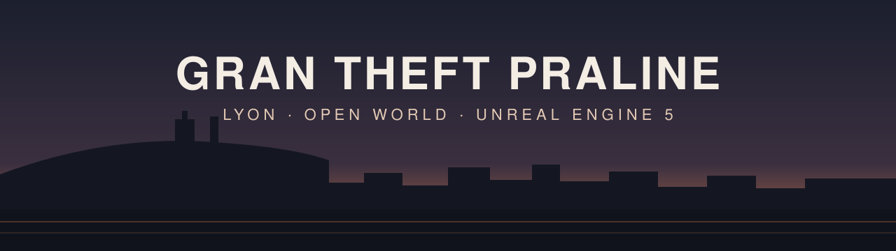

<p align="center">
  <a href="README.md">English</a> · <b>Français</b>
</p>

<p align="center">
  
</p>

<p align="center">
  <a href="LICENSE"></a>
  <a href="https://github.com/nic0lasm/Gran-Theft-Praline/actions/workflows/ci.yml"></a>
  
  
  
</p>

# Gran Theft Praline

**Un jeu en monde ouvert original, dans un Lyon fidèle et photoréaliste.**

Arpenter les rues de la Presqu'île, prendre le volant, entrer dans les
boutiques et les immeubles, avoir affaire à la police, dans une ville
reconstruite à partir de vraies données géographiques. L'ambition est
grande et assumée : la maniabilité, la richesse d'interactions et la
qualité d'image qu'on attend des meilleurs jeux en monde ouvert actuels,
sur la carte d'une vraie ville française.

La première zone jouable est une **tranche verticale du nord de la
Presqu'île**, de la place Bellecour à la place des Terreaux, entre les quais
de Saône et du Rhône (environ 1,5 km²).

> **Il n'y a pas encore de scénario, et c'est voulu.** On construit d'abord
> la base jouable : déplacements, conduite, armes, intérieurs accessibles,
> foule et circulation. L'intrigue, les personnages et le ton seront écrits
> une fois cette base en place.

Tout dans le jeu est original : aucune marque réelle, aucune personne
réelle, aucun asset repris d'autres jeux.

## Captures

Rien à montrer pour l'instant : les premières captures en jeu arriveront ici
avec la version 0.2 (*La rue habillée*). En attendant, les objectifs de rendu
et les mesures sont documentés dans
[docs/rendering/rendering-strategy.fr.md](docs/rendering/rendering-strategy.fr.md).

## Où en est le projet

Le projet est en **pré-production**. Le projet Unreal, la chaîne de données
géographiques, la stratégie de rendu et la feuille de route sont en place ;
une maquette grise de la rue de la République (334 bâtiments issus des
données IGN) sert aux mesures de performance. Rien n'est encore jouable.

Le jeu avance par **versions jouables** : chacune se lance d'un double-clic
et ajoute quelque chose à voir ou à faire.

| Version | Nom | On peut… | Cible |
| ---- | ---- | ---- | ---- |
| **0.1** | Jouer en un clic | lancer le jeu, marcher, courir, sauter rue de la République | 27 nov. 2026 |
| 0.2 | La rue habillée | flâner dans une rue photoréaliste à 30 i/s | déc. 2026 |
| 0.3 | Au volant | voler une voiture garée et rouler jusqu'au Rhône | janv. 2027 |
| 0.4 à 0.6 | Armé, première boutique, police | tirer, braquer une boutique, semer la police | mars 2027 |
| 0.7 à 0.13 | Tout le quartier | Bellecour → Terreaux avec foule, circulation, carte, économie, jour et nuit, météo | oct. 2027 |
| 0.14 à 0.18 | Qualité finale | façades, monuments, intérieurs, population, véhicules, son | avr. 2028 |
| **1.0** | Tranche verticale | une heure de jeu dans tout le quartier, sans blocage | **juin 2028** |

- Feuille de route complète : [production/roadmap.fr.md](production/roadmap.fr.md)
- Tableau de bord (tâche par tâche) : [production/roadmap-status.fr.md](production/roadmap-status.fr.md)
- Concept du jeu et tableaux de fonctionnalités : [design/gdd/game-concept.fr.md](design/gdd/game-concept.fr.md)

## Deux profils de qualité

Le photoréalisme passe en premier, quitte à ce que le jeu soit lourd. Chaque
version propose deux profils, au choix dans le menu des options :

| Profil | Ce que c'est | Cible |
| ---- | ---- | ---- |
| **Ultra** | La vraie cible visuelle : assets en pleine résolution, Nanite, Lumen haute qualité, lumière et matériaux sans compromis | Une machine puissante (carte graphique dédiée récente ou Apple Silicon haut de gamme) ; validé par des captures comparées à de vraies photos |
| **M1** | Le profil jouable au quotidien sur un portable Apple M1 Pro | 30 i/s en 1080p, 95 % des images ≤ 33,3 ms |

Le profil M1 ne baisse que les **réglages graphiques** : les modèles et les
matériaux ne sont jamais simplifiés pour le faire tenir. Détails dans
l'[ADR-0001](docs/adr/adr-0001-rendering-pipeline.fr.md) et
l'[ADR-0002](docs/adr/adr-0002-performance-budget.fr.md).

## Technologies

| Domaine | Choix |
| ---- | ---- |
| Moteur | Unreal Engine 5.8 : Lumen, Virtual Shadow Maps, Substrate, TSR |
| Code | C++ pour les systèmes de jeu, Blueprint pour prototyper |
| Plateforme | macOS sur Apple Silicon (Metal) d'abord, Windows ensuite |
| Socle gameplay | Briques gratuites d'Epic : Game Animation Sample, Gameplay Ability System, Chaos Vehicles, StateTree, Mass (foule et circulation) |
| Ville | IGN (BD TOPO, LiDAR HD, RGE ALTI), data.grandlyon.com, OpenStreetMap, traités par [tools/geo-pipeline](tools/geo-pipeline/) |
| Graphismes | Quixel Megascans, Tripo pour les modèles 3D, Blender pour le nettoyage et la mise en place |

## Construire et jouer

> Un build en un clic est l'objectif de la version **0.1** (cible le
> 27 novembre 2026). D'ici là, le projet s'ouvre seulement dans l'éditeur.

Prérequis : un Mac Apple Silicon, Unreal Engine 5.8 (Epic Games Launcher),
Xcode avec la chaîne d'outils Metal, et [Git LFS](https://git-lfs.com/).

```zsh
git lfs install
git clone https://github.com/nic0lasm/Gran-Theft-Praline.git
open Gran-Theft-Praline/GranTheftPraline/GranTheftPraline.uproject
```

Le script de packaging et les instructions de build pas à pas arriveront
dans `tools/build/` avec la version 0.1.

## Contribuer

Le projet est jeune et ses fondations bougent encore, mais les idées, les
retours, les signalements de bugs et la connaissance de Lyon sont les
bienvenus : ouvrez une [issue](https://github.com/nic0lasm/Gran-Theft-Praline/issues)
pour en discuter avant tout chantier important.

Fonctionnement du dépôt :

- **Branches** : travail sur `feat/<sujet>` ou `fix/<sujet>`. `next` est la
  branche de préproduction, `main` la branche de production. L'historique
  reste linéaire (rebase, avance rapide uniquement).
- **CI** : chaque push lance le *Provenance check*, qui vérifie l'identité
  des commits, les fichiers suivis et le nom des branches. Une modification
  ne passe sur `next`, puis `main`, qu'avec une CI verte sur ce commit précis.
- **Preuves** : toute modification visuelle ou de performance s'accompagne
  d'une capture ou d'une mesure.
- **Langues** : code, messages de commit et identifiants en anglais ;
  documentation en anglais et en français (`fichier.md` + `fichier.fr.md`).
- **Assets** : chaque asset externe ou généré a sa ligne dans
  [assets/SOURCES.md](assets/SOURCES.md), avec son origine et sa licence. Les
  gros binaires passent par Git LFS. Aucune marque ni personne réelle.

## Crédits et données

- Données géographiques : contient des données de l'**IGN** et de la
  **Métropole de Lyon** (Licence Ouverte Etalab) et **© les contributeurs
  d'OpenStreetMap** (ODbL).
- Les sources et licences des assets sont suivies une par une dans
  [assets/SOURCES.md](assets/SOURCES.md).
- Unreal Engine et ses contenus d'exemple sont utilisés selon la licence
  (EULA) d'Unreal Engine ; ils ne relèvent pas de la licence de ce dépôt.

## Licence

Le code et la documentation de ce dépôt sont publiés sous
[licence MIT](LICENSE). Les données et assets tiers conservent leurs propres
licences, recensées dans [assets/SOURCES.md](assets/SOURCES.md).
