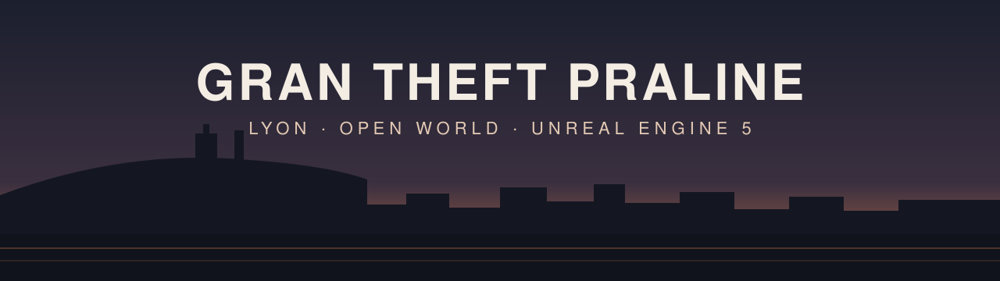

<p align="center">
  <b>English</b> · <a href="README.fr.md">Français</a>
</p>

<p align="center">
  
</p>

<p align="center">
  <a href="LICENSE"></a>
  <a href="https://github.com/nic0lasm/Gran-Theft-Praline/actions/workflows/ci.yml"></a>
  
  
  
</p>

<p align="center">
  <a href="#what-is-it">What is it?</a> ·
  <a href="#see-it-running">See it running</a> ·
  <a href="#play-in-one-click">Play</a> ·
  <a href="#roadmap">Roadmap</a> ·
  <a href="#build-it-yourself">Build</a> ·
  <a href="#contributing">Contribute</a> ·
  <a href="#credits-and-licence">Credits</a>
</p>

# Gran Theft Praline

**An original open-world game set in a faithful, photorealistic Lyon.**

Welcome! This is a fan-made, open-source and non-commercial attempt at
something big: the handling, interactions and image quality of the best
modern open-world games, on the real map of Lyon. Everyone is welcome to
follow along, try the builds, share their knowledge of the city or lend a
hand.

## What is it?

- **Lyon, for real.** The city is rebuilt from public geographic data (IGN,
  Métropole de Lyon, OpenStreetMap): real streets, real building heights,
  real trees and street furniture, and the **real shop signs** where they
  actually are.
- **A complete playground first.** Walking and driving, weapons, shops and
  buildings you can enter, police, crowds and traffic: at least the
  interactions players expect from a recent open-world game.
- **No story yet, on purpose.** The plot, characters and tone will be
  written once the playable base exists.
- **Photorealism first.** The visual reference is today's most realistic
  games; the camera and controls stay classic: third person, with an
  optional first-person view.
- **Starting small.** The first area is the **northern Presqu'île**, from
  Place Bellecour to Place des Terreaux, between the Saône and the Rhône
  (about 1.5 km²), starting with rue de la République.

No real people and no assets taken from other games. Trademarks shown in the
game belong to their owners: they are not covered by the MIT licence and are
not stored in this repository.

## See it running

Version 0.1, filmed by the game itself on a MacBook Pro M1 Pro. The street
is still a greybox built from 334 real IGN buildings: the real look arrives
with version 0.2.

<p align="center">
  
  
</p>

- 🎥 [Two-minute video of version 0.1](production/evidence/0.1/capture.mov)
  (37 MB)
- 📊 [Test results](production/evidence/0.1/): 10 minutes fullscreen without
  a crash, first frame 1.7 s after launch, frame time p50 41 ms / p95 51 ms
  (30 fps is the target from 0.2 onwards)
- 🖼️ [Rendering tests](docs/rendering/test-results/2026-11-09/) in four
  lighting setups (noon, golden hour, rain, night)

## Play in one click

Version **0.1 "Play in one click"** was delivered on **November 9, 2026**,
18 days ahead of its target date: double-click `GranTheftPraline.app`, press
*Play*, and you are in rue de la République.

Builds are not published for download yet: for now you
[build the app yourself](#-build-it-yourself) with a single script. It runs
on a Mac with Apple Silicon.

| Action | Keyboard (AZERTY) | Keyboard (QWERTY) | Gamepad |
| ---- | ---- | ---- | ---- |
| Move | Z Q S D | W A S D | Left stick |
| Look around | Mouse | Mouse | Right stick |
| Sprint (hold) | Left Shift | Left Shift | A / Cross |
| Walk (toggle) | Left Alt | Left Alt | Left stick click |
| Jump, vault | Space | Space | X / Square |
| Crouch | C | C | B / Circle |
| First / third person | V | V | View / Share |
| Pause menu | Escape | Escape | Menu / Options |

Full details: [player character](docs/gameplay/player-character.md).

## Roadmap

The game moves forward in **playable versions**: each one launches with a
double-click and adds something you can see or do.

| Version | Name | You can… | Target | Status |
| ---- | ---- | ---- | ---- | ---- |
| **0.1** | Play in one click | launch the game and walk, run, jump in rue de la République | Nov 2026 | ✅ delivered Nov 9 |
| 0.2 | The dressed street | stroll down a photorealistic rue de la République at 30 fps | Dec 2026 | 🟡 under way |
| 0.3 | Behind the wheel | get into a parked car and drive to the Rhône | Jan 2027 | 🟡 design done |
| 0.4 to 0.6 | Armed, first shop, police | shoot, rob a shop, lose the police | Mar 2027 | ⬜ |
| 0.7 to 0.13 | The whole district | Bellecour → Terreaux with crowds, traffic, map, economy, day and night, weather | Oct 2027 | ⬜ |
| 0.14 to 0.19 | Final quality | façades, monuments, interiors, people, cars, the sound of Lyon, polish | May 2028 | ⬜ |
| **1.0** | Vertical slice | one hour of play across the district, no blocker | **Jun 2028** | ⬜ |

What is cooking right now:

- **0.2**: the rendering settings that hold 30 fps on an M1 laptop, the first
  wave of 3D models (street furniture: benches, bus shelters, bollards…),
  and a more faithful 3D rebuild of the Presqu'île (LiDAR terrain and roofs).
- **0.3**: the drivable vehicles, based on cars you actually see in France
  (Clio, 208, Kangoo, Golf, Yaris…), plus TCL buses and Vélo'v bikes.

Follow along:

- [Full roadmap](production/roadmap.md): every version in detail, risks,
  dependencies
- [Live dashboard](production/roadmap-status.md): task by task, with the
  evidence for each one
- [Game concept](design/gdd/game-concept.md) and
  [3D model catalogue](production/asset-catalog.md)

### Two quality profiles

| Profile | What it is | Target |
| ---- | ---- | ---- |
| **Ultra** | The real visual target: full-resolution assets, Nanite, high-quality Lumen | A powerful machine (recent dedicated GPU or high-end Apple Silicon) |
| **M1** | The everyday playable profile on an Apple M1 Pro laptop | 30 fps at 1080p, 95 % of frames ≤ 33.3 ms |

The M1 profile only lowers graphics settings; models and materials are never
simplified. See [ADR-0001](docs/adr/adr-0001-rendering-pipeline.md) and
[ADR-0002](docs/adr/adr-0002-performance-budget.md).

## Build it yourself

### Requirements

- A Mac with Apple Silicon
- [Unreal Engine 5.8](https://www.unrealengine.com/) (Epic Games Launcher)
- Xcode with the Metal toolchain
- [Git LFS](https://git-lfs.com/)
- Python 3 (city and asset tools)

Some content is **not stored in Git**, for licence or size reasons, and is
installed or regenerated locally:

| Content | How to get it |
| ---- | ---- |
| Epic's Game Animation Sample (character, animations, camera) | Free on Fab, then [`tools/character/install_gasp_content.sh`](tools/character/README.md) |
| The rue de la République level | Generated from the IGN greybox by [`tools/level`](tools/level/README.md) |
| City data (OpenStreetMap tables) | Regenerated by [`tools/city`](docs/city/plan.md) (ODbL, no key needed) |
| High-quality 3D models | Kept outside Git; prepared for Unreal by [`tools/assets`](docs/assets/import-pipeline.md) |
| Real brand logos and textures | Kept outside Git in `Plugins/CityBrands/` |

### Steps

```zsh
git lfs install
git clone https://github.com/nic0lasm/Gran-Theft-Praline.git
open Gran-Theft-Praline/GranTheftPraline/GranTheftPraline.uproject
```

Then, once the content above is installed:

```zsh
tools/build/package-mac.sh        # → Builds/0.1/GranTheftPraline.app
tools/build/test-build-mac.sh     # 10-minute test, video and frame times
```

Step-by-step guide: [one-click macOS build](docs/build/one-click-build.md).

### Technology

| Area | Choice |
| ---- | ---- |
| Engine | Unreal Engine 5.8: Lumen, Virtual Shadow Maps, Substrate, TSR |
| Code | C++ for the game systems, Blueprint for prototyping |
| Platform | macOS on Apple Silicon (Metal) first, Windows later |
| Gameplay foundations | Epic's free building blocks: Game Animation Sample, Gameplay Ability System, Chaos Vehicles, StateTree, Mass |
| City | IGN (BD TOPO, LiDAR HD, RGE ALTI), data.grandlyon.com and OpenStreetMap, processed by [tools/city](tools/city/) and [tools/geo-pipeline](tools/geo-pipeline/) |
| Art | Quixel Megascans, Tripo for 3D models, Blender; see the [art bible](docs/art/art-bible.md) |

## Contributing

The foundations are still moving, but your help is very welcome, and you
don't need to write code:

- **Know Lyon?** Point out a missing shop, a wrong building height, a
  detail that makes a street feel right.
- **Tried a build?** Tell us how it runs on your Mac (model, frame rate,
  problems).
- **Unreal, 3D, sound, design?** Pick a version on the
  [roadmap](production/roadmap.md) and suggest what you would like to take on.

Open an [issue](https://github.com/nic0lasm/Gran-Theft-Praline/issues) to
start the conversation, especially before a large piece of work.

How the repository works:

- **Branches**: work on `feat/<topic>` or `fix/<topic>`. `next` is the
  pre-release branch, `main` the release branch. History stays linear
  (rebase, fast-forward only).
- **CI**: every push runs the *Provenance check* (commit identities, tracked
  files, branch names) and the tool tests. A change moves to `next`, then
  `main`, only once CI is green on that exact commit.
- **Evidence**: a visual or performance change comes with a screenshot or a
  measurement.
- **Languages**: code, commit messages and identifiers in English;
  documentation in English and French (`file.md` + `file.fr.md`).
- **Assets**: every external or generated asset gets a row in
  [assets/SOURCES.md](assets/SOURCES.md) with its origin and licence. Large
  binaries go through Git LFS ([rules](docs/project/git-lfs.md)).

## Credits and licence

- Geographic data: contains data from **IGN** (BD TOPO, LiDAR HD, RGE ALTI)
  and **Métropole de Lyon** (Licence Ouverte / Etalab Open Licence), and
  **© OpenStreetMap contributors** ([ODbL](https://opendatacommons.org/licenses/odbl/)).
- **Epic Games**: Unreal Engine and the Game Animation Sample are used under
  the Unreal Engine EULA and are not covered by this repository's licence.
- Shop signs and brands belong to their owners; they are reproduced for a
  non-commercial project and are not distributed in this repository.
- Every asset's source and licence: [assets/SOURCES.md](assets/SOURCES.md).

The code and documentation in this repository are released under the
[MIT License](LICENSE). Third-party data and assets keep their own licences.

<p align="center"><i>Made in Lyon, with love for its streets. 🦁</i></p>
