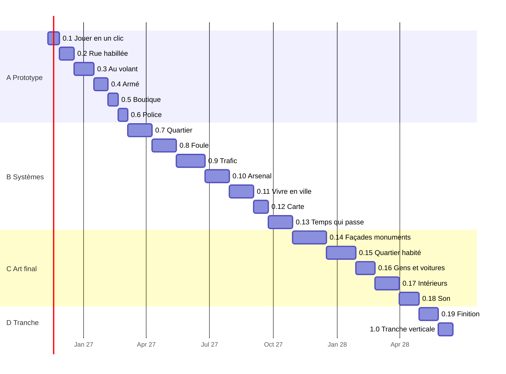

# Roadmap de développement : Gran Theft Praline

*Version anglaise : [roadmap.md](roadmap.md)*
*Version 2, 2026-11-09 : roadmap découpée en versions jouables numérotées (0.1 → 1.0).*
*Suivi au jour le jour : [roadmap-status.fr.md](roadmap-status.fr.md). Assets à générer : [asset-catalog.fr.md](asset-catalog.fr.md).*
*Entrées : [concept](../design/gdd/game-concept.fr.md), [stratégie de rendu](../docs/rendering/rendering-strategy.fr.md),
[ADR-0001](../docs/adr/adr-0001-rendering-pipeline.fr.md), [ADR-0002](../docs/adr/adr-0002-performance-budget.fr.md),
[recensement des assets](../docs/sourcing/asset-sourcing.fr.md).*

---

## 1. Comment lire cette roadmap

- Le jeu avance par **versions jouables** : 0.1, 0.2, 0.3… jusqu'à la
  **1.0 = tranche verticale** (nord de la Presqu'île, Bellecour → Terreaux,
  toutes les fonctions P0 du concept en qualité finale).
- **Chaque version se lance en un clic** sur le Mac (application macOS
  empaquetée) et apporte quelque chose qu'on peut voir ou faire en jouant.
- Chaque version a la même fiche : **objectif** en une phrase, critère
  **« fait quand »** vérifiable (mesure, capture ou vidéo), **tâches**
  courtes, **dépendances**, **fils** qui peuvent travailler en parallèle,
  **assets** à générer, **estimation**.
- Une version est terminée quand son critère est vérifié par une mesure ou
  une capture, que la CI est verte et que le commit est avancé sur `next`
  puis `main`. Le build de la version est rangé dans
  `GTAL/Builds/<version>/` sur le Mac.
- Les dates sont des cibles, revues à la fin de chaque version.

### Deux niveaux de qualité : le photoréalisme d'abord

Le but reste le **photoréalisme**, même si le jeu devient lourd en poids et
en calcul. Le MacBook Pro M1 ne fera donc pas tourner la version la plus
belle dans un premier temps. Chaque version est construite avec deux
profils de qualité, choisis dans le menu d'options du jeu :

| Profil | Rôle | Critère |
| ---- | ---- | ---- |
| **Ultra (photoréaliste)** | La cible visuelle : assets en pleine résolution, Nanite et Lumen matériel activés là où la machine le permet, éclairage et matériaux sans compromis | Validé par captures (Movie Render Queue) comparées aux photos réelles, même si le M1 ne le rend qu'à quelques images par seconde |
| **M1 (jouable)** | Ce qu'on joue au quotidien sur le MacBook Pro M1 Pro 16 Go | 95 % des images ≤ 33,3 ms en 1080p (ADR-0002) dans la build empaquetée |

Le profil M1 est **dérivé** du profil Ultra (LOD, textures réduites, Lumen
logiciel allégé, densités) et jamais l'inverse : on ne baisse pas la
qualité des assets sources pour faire tenir le M1. Le profil Ultra
deviendra jouable sur une machine plus puissante le jour où Nico le
décidera. Ces deux niveaux sont ceux définis dans l'ADR-0001 et l'ADR-0002
(niveaux Ultra et M1).

Dans les fiches ci-dessous, « budget tenu » veut dire : profil M1 dans le
budget de l'ADR-0002, mesuré dans la build empaquetée.

### Les quatre grandes étapes

| Étape | Versions | Ce qu'on obtient | Cible |
| ---- | ---- | ---- | ---- |
| **A. Prototype jouable** | 0.1 → 0.6 | Une rue de Lyon où l'on marche, conduit, tire, braque une boutique et sème la police | début mars 2027 |
| **B. Tout le quartier en systèmes** | 0.7 → 0.13 | Bellecour → Terreaux en greybox, foule, trafic, carte, économie, météo | fin octobre 2027 |
| **C. Quartier en qualité finale** | 0.14 → 0.18 | Façades, monuments, habillage, population, véhicules, intérieurs, son | avril 2028 |
| **D. Tranche verticale** | 0.19 → 1.0 | Finition, performance, une heure de jeu sans bloquant | juin 2028 |
| Ensuite | 1.x | Nouveaux quartiers, fonctions P1, histoire écrite avec Nico | 2028+ |

---

## 2. Où on en est (2026-11-09)

| Domaine | État |
| ---- | ---- |
| Environnement | Fait : projet UE 5.8, repo, CI « Provenance check », règles de travail |
| Concept | Fait : tableaux de parité P0-P2, tranche verticale = nord de la Presqu'île |
| Rendu | ADR-0002 accepté (30 i/s, 1080p, 95 % des images ≤ 33,3 ms), à appliquer au profil M1. ADR-0001 proposé, à amender pour le profil Ultra |
| Scène témoin | Greybox de la rue de la République (BD TOPO IGN, 334 bâtiments, 367 m), 4 éclairages. **Mesurée hors budget : 43 à 51 ms** (GPU limitant) |
| Assets | Abonnement Tripo Studio Max actif (25 200 crédits Studio), outil `tools/tripo/` en cours |
| Code gameplay | Aucun. **Rien n'est encore jouable** |

---

## 3. Vue d'ensemble des versions

| Version | Nom | On peut… | Cible |
| ---- | ---- | ---- | ---- |
| **0.1** | Jouer en un clic | lancer le jeu d'un double-clic et marcher, courir, sauter dans la rue de la République | 2026-11-27 |
| **0.2** | La rue habillée | se promener dans une rue photoréaliste en profil Ultra (captures) et à 30 i/s en profil M1, sous 4 éclairages | 2026-12-18 |
| **0.3** | Au volant | voler une voiture garée et rouler jusqu'au quai du Rhône | 2027-01-15 |
| **0.4** | Armé | tirer, se mettre à couvert, se battre, mourir et réapparaître | 2027-02-05 |
| **0.5** | Première boutique | entrer dans une boutique sans chargement, acheter, la braquer | 2027-02-19 |
| **0.6** | La police arrive | être recherché (niveaux 1-2), poursuivi, et semer la police | 2027-03-05 |
| **0.7** | Tout le quartier | parcourir Bellecour → Terreaux à pied et en voiture | 2027-04-09 |
| **0.8** | La foule | croiser des centaines de piétons qui réagissent | 2027-05-14 |
| **0.9** | Le trafic | rouler dans une circulation avec feux et priorités | 2027-06-25 |
| **0.10** | L'arsenal | choisir parmi 6 armes, affronter une police niveau 3 et ses barrages | 2027-07-30 |
| **0.11** | Vivre en ville | gagner et dépenser de l'argent dans 5 types de boutiques, sauvegarder dans une planque | 2027-09-03 |
| **0.12** | La carte | ouvrir la carte de Lyon avec les vrais noms de rues et suivre le GPS | 2027-09-24 |
| **0.13** | Le temps qui passe | vivre jour, nuit et météo, rouler en deux-roues, faire 6 activités libres | 2027-10-29 |
| **0.14** | Les façades et monuments | voir le quartier en façades finales, Hôtel de Ville, Opéra, Bellecour, ponts | 2027-12-17 |
| **0.15** | Le quartier habité | voir trottoirs, enseignes fictives, végétation et mobilier sur tout le quartier | 2028-01-28 |
| **0.16** | Les gens et les voitures | croiser une population et une police réalistes, 6 véhicules finaux | 2028-02-25 |
| **0.17** | Les intérieurs | entrer dans 30 boutiques, 10 bâtiments, 3 planques en qualité finale | 2028-03-31 |
| **0.18** | Le son de Lyon | entendre la ville : pas, moteurs, armes, ambiance par rue | 2028-04-28 |
| **0.19** | Finition | jouer une heure sans bloquant, dans le budget partout | 2028-05-26 |
| **1.0** | Tranche verticale | jouer la tranche verticale complète, revue de parité face à la référence | 2028-06-16 |

L'art final ne démarre pas en 0.14 : il est **produit en avance** (vagues
Tripo, kits de façades, photos) pendant les étapes A et B, et **intégré**
dans les versions 0.14 à 0.17. Voir la section 5.

---

## 4. Détail des versions

Légende des fils : chaque ligne « Fils » propose des sujets qu'on peut
confier à des fils différents en même temps. Les fils qui ouvrent l'éditeur
Unreal sur le Mac passent l'un après l'autre (une seule session d'éditeur
à la fois sur 16 Go) ; les fils de documentation, de scripts, de données
géo et de génération Tripo tournent en parallèle sans limite.

### Étape A : prototype jouable

#### 0.1 Jouer en un clic

**Objectif.** Un double-clic sur `GranTheftPraline.app` lance le jeu et on
contrôle un personnage dans la rue de la République en greybox.

**Fait quand :**
- `GTAL/Builds/0.1/GranTheftPraline.app` démarre d'un double-clic en moins
  de 30 secondes, sans éditeur, sans terminal.
- Écran titre avec « Jouer » et « Quitter », menu pause (Échap), retour au
  bureau propre.
- Le personnage marche, court, saute, s'accroupit ; caméra façon GTA
  (troisième personne, bascule en première personne) réglable à la souris
  et à la manette ; collisions sur tous les bâtiments ; impossible de tomber hors du monde.
- Une vidéo de 2 minutes et un relevé de temps d'image (CSV) de la build
  empaquetée sont versionnés comme preuves. Le budget 30 i/s n'est **pas**
  exigé en 0.1 : il l'est à partir de 0.2.
- 10 minutes de jeu sans plantage.

**Tâches :**
1. Passer le projet en C++ : module `GranTheftPraline`, `GameMode`,
   `PlayerController`, `GameInstance` minimaux.
2. Règles Git LFS pour `.uasset`, `.umap` et binaires ; vérifier le quota.
3. Intégrer le Game Animation Sample (personnage, motion matching,
   caméra) dans `Content/Characters/`.
4. Enhanced Input : clavier-souris et manette, actions déplacer, regarder,
   sauter, sprinter, s'accroupir.
5. Transformer la greybox de la scène témoin en niveau jouable
   `L_RueRepublique` : collisions, PlayerStart, kill-Z, volumes de limite.
6. Écran titre et menu pause (UMG).
7. Script `tools/build/package-mac.sh` (BuildCookRun, Shipping, signature
   ad hoc) qui produit l'application dans `GTAL/Builds/<version>/`.
8. Lancer la build, filmer, mesurer le temps d'image, archiver les preuves.

**Dépend de :** scène témoin (branche `feat/reference-scene`, à fusionner).

**Fils en parallèle :**
- *Build et lancement en un clic* (tâches 1, 2, 6, 7, 8) : chemin critique.
- *Personnage jouable* (tâches 3, 4).
- *Rue de la République jouable* (tâche 5, fusion de la scène témoin).
- *Vague Tripo 1* : génère déjà le mobilier urbain de la 0.2 (voir catalogue).

**Assets :** aucun asset final nécessaire. Vague Tripo 1 lancée en avance.

**Estimation :** 2 à 3 semaines, une demi-heure de Nico pour tester la build.

#### 0.2 La rue habillée

**Objectif.** La rue de la République ressemble à une vraie rue lyonnaise en
profil Ultra, et le profil M1 se joue dans le budget de l'ADR-0002.

**Fait quand :**
- Profil Ultra : captures des 4 éclairages (midi, heure dorée, pluie,
  nuit) mises à côté de photos réelles de la rue, jugées crédibles par Nico.
- Profil M1 : 95 % des images ≤ 33,3 ms dans la build empaquetée, sous les
  4 éclairages, mesuré par CSV.
- Choix du profil dans le menu d'options du jeu.
- ADR-0001 amendé : profil Ultra et profil M1, avec les chiffres.
- Façades kit v1 (8 à 12 modules), sols Megascans, au moins 40 objets de
  mobilier urbain issus de la vague Tripo 1, tous inscrits dans
  `assets/SOURCES.md`.
- Touche en jeu pour changer d'éclairage ; heure dorée et nuit corrigées.
- Captures comparées à des photos réelles de la rue.

**Tâches :**
1. Définir les deux profils (Scalability et Device Profiles) ; choisir les
   leviers du profil M1 (Lumen Lite, résolution interne 50 %, autre) par
   carte à Nico, avec chiffres et images comparatives Ultra / M1.
2. Kit de façades v1 (Blender + textures photo).
3. Sols et trottoirs Megascans en pleine résolution (pavés, asphalte,
   bordures), variantes réduites pour le profil M1.
4. Nettoyer et importer la vague Tripo 1 (LOD, collisions, matériaux).
5. Corriger exposition de l'heure dorée et de la nuit.
6. Sélecteur d'éclairage en jeu.
7. Mesure complète et rapport.

**Dépend de :** 0.1.

**Fils en parallèle :** *Atteindre le photoréalisme* (tâches 1, 5, 6, 7),
*Kit de façades v1* (2, 3), *Vague Tripo 1* (4).

**Assets :** vague Tripo 1, mobilier urbain (60 modèles).

**Estimation :** 3 semaines.

#### 0.3 Au volant

**Objectif.** On vole une voiture garée et on la conduit de la rue de la
République jusqu'au quai du Rhône.

**Fait quand :**
- Une voiture réelle du parc français (Clio V) à conduite physique (Chaos Vehicles) : accélération,
  freinage, frein à main, dérapage contrôlable, caméra de poursuite.
- Monter, descendre, éjecter un conducteur PNJ, ouvrir une voiture garée.
- Dégâts simples (carrosserie déformée, vitres cassées).
- Greybox étendue au quai du Rhône et au pont le plus proche.
- Vidéo d'un trajet de 3 minutes ; budget 30 i/s tenu en conduisant.

**Tâches :** ADR-0003 (déplacement) ; Smart Objects pour portes et sièges ;
véhicule Chaos et réglages ; animations entrer/sortir ; dégâts ; extension
géo au quai ; mesure.

**Dépend de :** 0.1 (personnage), pipeline géo pour le quai.

**Fils en parallèle :** *Véhicules*, *Interactions contextuelles*,
*Reproduction de la ville : quai et pont*, *Vague Tripo 2* (carrosseries).

**Assets :** vague Tripo 2, véhicules et objets de rue liés (30 modèles).

**Estimation :** 4 semaines.

#### 0.4 Armé

**Objectif.** On se bat : pistolet, visée, couverture, corps à corps, mort
et réapparition.

**Fait quand :**
- Pistolet : viser, tirer, recharger, impacts sur les surfaces, réactions
  des cibles.
- Couverture contre murs et voitures, corps à corps (coups, esquive).
- Santé, armure, mort, réapparition à l'hôpital le plus proche (fictif).
- Mannequins d'entraînement ou PNJ hostiles simples.
- Vidéo d'un combat de 2 minutes, budget tenu.

**Tâches :** ADR-0004 (framework gameplay : Gameplay Ability System,
Enhanced Input, StateTree) ; attributs et capacités ; arme et munitions ;
couverture ; corps à corps ; mort et réapparition ; PNJ hostiles basiques.

**Dépend de :** 0.1.

**Fils en parallèle :** *Combat et armes*, *Santé et réapparition*,
*Vague Tripo 3* (armes fictives, accessoires).

**Assets :** vague Tripo 3, armes et accessoires (25 modèles).

**Estimation :** 3 semaines.

#### 0.5 Première boutique

**Objectif.** On entre dans une boutique sans écran de chargement, on y
achète et on peut la braquer.

**Fait quand :**
- Porte qui s'ouvre, intérieur meublé chargé à la volée (Level Instance ou
  data layer).
- Vendeur PNJ (StateTree) qui sert, se rend ou appelle la police.
- Achat d'un objet, braquage avec caisse, argent affiché.
- Vidéo d'un braquage ; budget tenu en entrant et sortant.

**Tâches :** ADR-0005 (streaming : cellules World Partition, HLOD, data
layers) ; intérieur de boutique en kit ; PNJ vendeur ; braquage ; argent.

**Dépend de :** 0.4 (menace avec une arme), interactions de 0.3.

**Fils en parallèle :** *Boutiques et intérieurs*, *IA des PNJ*,
*Vague Tripo 4* (intérieur de boutique).

**Assets :** vague Tripo 4, mobilier et produits d'une boutique (40 modèles).

**Estimation :** 2 semaines.

#### 0.6 La police arrive

**Objectif.** Un crime déclenche une recherche de niveau 1 ou 2 que l'on
peut semer.

**Fait quand :**
- Témoins qui signalent, niveaux de recherche 1 et 2, zone de recherche.
- Patrouille à pied et en voiture, poursuite, arrestation.
- On sème la police en sortant de la zone ou en se cachant.
- HUD minimal : santé, argent, niveau de recherche, arme.
- **Jalon « Maniabilité jouable »** : boucle de 10 minutes (marcher, voler
  une voiture, rouler sur le quai, braquer la boutique, semer la police)
  filmée, budget tenu, rapport de playtest qui note chaque verbe face à la
  référence.

**Tâches :** perception des PNJ ; système de recherche ; IA de police
(StateTree) à pied et en voiture ; HUD ; playtest de Nico.

**Dépend de :** 0.3, 0.4, 0.5.

**Fils en parallèle :** *Police et recherche*, *Interface*, *Vague Tripo 5*
(équipement de police fictif).

**Assets :** vague Tripo 5, police fictive et signalétique (20 modèles).

**Estimation :** 3 semaines, une heure de playtest de Nico.

### Étape B : tout le quartier en systèmes (greybox)

#### 0.7 Tout le quartier

**Objectif.** On parcourt tout Bellecour → Terreaux, quais et ponts compris,
sans chargement et dans le budget.

**Fait quand :** pipeline géo v1 (BD TOPO, LiDAR HD, OSM) qui produit le
quartier en une commande ; World Partition et HLOD ; trajet Bellecour →
Terreaux à pied et en voiture filmé ; 95 % des images ≤ 33,3 ms sur le
trajet ; mémoire ≤ 9 Go GPU.

**Fils :** *Reproduction de la ville* (pipeline géo), *Streaming du monde*,
*Kit de façades v2* (démarre, intégré en 0.14).

**Assets :** vague Tripo 6, mobilier des places (Bellecour, Terreaux,
Jacobins, République) (50 modèles).

**Estimation :** 5 semaines.

#### 0.8 La foule

**Objectif.** Des centaines de piétons vivent dans le quartier et réagissent
au joueur.

**Fait quand :** foule Mass (MassCrowd) sur trottoirs et places, densité
réglable, fuite face aux armes, budget tenu à densité cible ; repli en
acteurs testé.

**Fils :** *Foule*, *IA des PNJ*, *Vague Tripo 7* (objets portés, accessoires
de piétons).

**Assets :** vague Tripo 7 (30 modèles).

**Estimation :** 5 semaines.

#### 0.9 Le trafic

**Objectif.** Une circulation crédible : voies issues des vraies rues,
feux, priorités, réactions aux accidents.

**Fait quand :** réseau de voies généré depuis les données géo, feux et
passages piétons, voitures qui évitent, klaxonnent, fuient ; budget tenu.

**Fils :** *Trafic*, *Reproduction de la ville* (voies et feux),
*Vague Tripo 8* (feux, panneaux génériques, mobilier routier).

**Assets :** vague Tripo 8 (40 modèles).

**Estimation :** 6 semaines.

#### 0.10 L'arsenal

**Objectif.** Le combat complet : 6 armes, roue d'armes, inventaire, police
niveau 3 avec barrages.

**Fait quand :** 6 armes fictives réglées, roue d'armes, réactions aux
impacts, niveau 3, barrages, poursuites en voiture.

**Fils :** *Combat et armes*, *Police et recherche*, *Vague Tripo 9*.

**Assets :** vague Tripo 9, armes et équipement (30 modèles).

**Estimation :** 5 semaines.

#### 0.11 Vivre en ville

**Objectif.** Une économie : 5 types de boutiques, achats, planques,
sauvegarde.

**Fait quand :** 5 types de boutiques jouables (alimentation, vêtements,
armurerie, garage, bar ou café), 3 planques, sauvegarde et chargement
fiables, argent persistant.

**Fils :** *Boutiques et intérieurs*, *Économie et sauvegarde*,
*Vagues Tripo 10 et 11* (intérieurs par type de boutique).

**Assets :** vagues Tripo 10-11, intérieurs (120 modèles).

**Estimation :** 5 semaines.

#### 0.12 La carte

**Objectif.** Carte et mini-carte de Lyon avec les vrais noms de rues, GPS,
menus complets.

**Fait quand :** tuiles de carte issues de nos données géo, GPS qui suit les
sens de circulation, menus options et accessibilité de base (sous-titres,
remappage, daltonisme).

**Fils :** *Interface et carte*, *Reproduction de la ville* (tuiles, noms).

**Estimation :** 3 semaines.

#### 0.13 Le temps qui passe

**Objectif.** Jour, nuit et météo dynamiques, deux-roues, activités libres.

**Fait quand :** cycle jour-nuit et météo qui tiennent le budget, scooter,
moto et vélo, 6 activités libres du concept ; **jalon « Systèmes P0
complets »** : chaque ligne P0 du concept cochée en greybox.

**Fils :** *Heure et météo*, *Véhicules (deux-roues)*, *Activités*,
*Vague Tripo 12* (deux-roues, mobilier d'activités).

**Assets :** vague Tripo 12 (30 modèles).

**Estimation :** 5 semaines.

### Étape C : quartier en qualité finale

Les assets de cette étape sont produits pendant A et B ; ces versions les
intègrent, les règlent et les mesurent.

| Version | Fait quand | Fils | Assets |
| ---- | ---- | ---- | ---- |
| **0.14 Façades et monuments** | Kit de façades v2 sur tout le quartier ; Hôtel de Ville, Opéra, place Bellecour et sa statue, ponts en qualité finale ; captures Ultra des 4 éclairages, profil M1 dans le budget sur tout le quartier | *Kit de façades v2*, *Monuments*, *Photoréalisme* | Photos de terrain, Blender ; Tripo pour les éléments décoratifs (vague 13, 60 modèles) |
| **0.15 Le quartier habité** | Habillage PCG (mobilier, végétation, enseignes fictives générées et vérifiées) sur tout le quartier ; grille visuelle ≥ 4/5 face aux photos | *Habillage PCG*, *Enseignes fictives* | Vague 14, végétation, devantures, détails (80 modèles) |
| **0.16 Les gens et les voitures** | Population et police MetaHuman (visages fictifs), 6 véhicules finaux (modèles réels du parc français), voiture de police | *Personnages*, *Véhicules finaux* | Vague 15, carrosseries finales et accessoires de personnages (40 modèles) |
| **0.17 Les intérieurs** | 30 boutiques, 10 bâtiments accessibles, 3 planques, hall et parking en qualité finale | *Intérieurs* | Vagues 16-17, mobilier intérieur final (150 modèles) |
| **0.18 Le son de Lyon** | Pas par surface, moteurs, armes, ambiance par rue, réverbération ; prises de son à Lyon | *Audio* | Bibliothèques libres + prises de son |

### Étape D : tranche verticale

| Version | Fait quand | Fils |
| ---- | ---- | ---- |
| **0.19 Finition** | Saccades, mémoire, bugs ; une heure de jeu libre sans bloquant en profil M1 ; budget tenu partout ; captures Ultra de tout le quartier ; étude du mode 60 i/s | *Performance*, *Qualité*, *Sensations* (playtests de Nico) |
| **1.0 Tranche verticale** | Revue de parité face à la référence ligne par ligne ; vidéo de présentation ; décision de Nico sur la suite (quartier suivant, histoire) | *Revue de parité*, *Présentation* |

### Après la 1.0

Versions 1.x : un quartier à la fois (sud de la Presqu'île, Vieux-Lyon,
pentes de la Croix-Rousse, rive gauche, Fourvière), fonctions P1 du concept
(téléphone, personnalisation, garages, nage…) et l'histoire écrite avec
Nico. Environ 4 à 6 mois par quartier, chacun décidé par Nico.

---

## 5. Production d'assets avec Tripo

L'abonnement Tripo Studio Max (25 200 crédits Studio, dépensés uniquement
dans l'interface web Studio) est utilisé **en continu, en avance sur
l'intégration** : chaque version a sa vague de modèles listée dans le
[catalogue](asset-catalog.fr.md).

- **Ce que Tripo fait bien ici :** objets isolés de taille petite à moyenne
  (mobilier urbain, accessoires, mobilier intérieur, produits, armes,
  ébauches de carrosseries, éléments décoratifs).
- **Ce qu'on ne lui confie pas :** façades et bâtiments (kits modulaires et
  données géo), terrain, personnages jouables (MetaHuman), monuments
  complets (photos et Blender ; Tripo seulement pour les ornements).
- **Flux :** catalogue → images de référence (Flux, GPT Image) quand c'est
  utile → dizaines de générations en parallèle dans Studio → export GLB vers
  `assets/tripo/<vague>/` → nettoyage Blender (échelle, pivot, LOD,
  collisions) → import Unreal → ligne dans `assets/SOURCES.md` → statut dans
  le catalogue.
- **Master et variante légère :** chaque modèle est gardé en **master haute
  qualité** (génération et textures à la résolution maximale, GLB d'origine
  conservé) et décliné en **variante légère** (polygones et textures
  réduits) pour le profil M1. Dans Unreal, le master sert au profil Ultra
  (Nanite activé quand la machine le permet) et la variante légère aux LOD
  du profil M1.
- **Stockage :** les GLB masters sont lourds et restent **hors Git**. Le
  repo ne contient que les assets Unreal intégrés (Git LFS) et le
  catalogue. Où ranger les masters (disque externe, stockage en ligne,
  dossier `GTAL/AssetsMaster/` non versionné en attendant) est une décision
  de Nico à prendre avant la fin de la vague 1.
- **Rythme cible :** une vague de 20 à 60 modèles toutes les deux à trois
  semaines, soit environ 800 modèles d'ici la 0.17. Le coût réel en crédits
  par modèle est mesuré sur la vague 1 et le rythme ajusté pour consommer
  les crédits avant leur expiration.
- **Garde-fous :** les vraies enseignes et marques viennent des photos
  terrain, jamais de Tripo ([bible artistique](../docs/art/art-bible.fr.md)) ; aucun objet copié d'un
  jeu existant ; chaque modèle passe une revue visuelle avant d'entrer dans
  le jeu.

---

## 6. Systèmes, versions et dépendances

| # | Système | Version | Dépend de | Point de départ |
| ---- | ---- | ---- | ---- | ---- |
| 1 | Code de base (game mode, Enhanced Input, debug, packaging) | 0.1 | rien | Modèles Epic, Lyra en lecture |
| 2 | Monde et streaming (World Partition, HLOD, data layers, import géo) | 0.1, 0.5, 0.7 | pipeline géo | `extract_bbox.py`, PCG |
| 3 | À pied et caméra | 0.1 | 1 | Game Animation Sample |
| 4 | Interactions contextuelles | 0.3 | 3 | Smart Objects, Gameplay Interaction |
| 5 | Véhicules | 0.3, 0.13, 0.16 | 3, 4 | Chaos Vehicles |
| 6 | Armes et combat | 0.4, 0.10 | 1, 3 | Gameplay Ability System |
| 7 | Santé, mort, réapparition | 0.4 | 6 | Attributs GAS |
| 8 | IA des PNJ | 0.5, 0.8 | 1, 4 | StateTree, AI Perception, Smart Objects |
| 9 | Police et recherche | 0.6, 0.10 | 5, 6, 8 | Système maison sur StateTree |
| 10 | Boutiques et intérieurs | 0.5, 0.11, 0.17 | 2, 4, 8 | Level Instances, data layers |
| 11 | Économie, planques, sauvegarde | 0.11 | 7, 10 | Save Game |
| 12 | Foule | 0.8 | 2, 8 | Mass, MassCrowd ; repli en acteurs |
| 13 | Trafic | 0.9 | 5, 12 | Mass ou splines issues des routes géo |
| 14 | Heure et météo | 0.2, 0.13 | rendu | SunPosition, Sky Atmosphere, contrôleur de la scène témoin |
| 15 | Interface, carte, GPS | 0.1, 0.6, 0.12 | 2, 11 | UMG, Common UI |
| 16 | Audio | continu, 0.18 | 3, 5, 6 | MetaSounds |
| 17 | Deux-roues | 0.13 | 5 | Chaos Vehicles |

*Décidé par Nico le 2026-11-09 : socle gameplay sur les briques Epic
gratuites (Game Animation Sample, Gameplay Ability System, Chaos Vehicles,
StateTree, Mass) ; police et boutiques écrites par nous.*

---

## 7. Effort et équipe

- **Nico** (environ 10 h par semaine) : décisions par cartes, playtests des
  sensations à chaque version (une demi-heure à une heure), photos de
  terrain à Lyon (rue témoin, puis quartier, puis monuments).
- **Production assistée par IA** : code, scripts, données géo, génération et
  nettoyage d'assets, mesures et captures sur le Mac, documentation.
- **Goulots :** réglage des sensations (demande Nico), volume d'art final,
  un seul Mac de 16 Go (éditeur, shaders, packaging et mesures en série).

| Étape | Durée | Confiance |
| ---- | ---- | ---- |
| A Prototype (0.1-0.6) | environ 16 semaines | Moyenne |
| B Systèmes (0.7-0.13) | environ 8 mois | Faible, replanifiée à 0.6 |
| C Art final (0.14-0.18) | environ 6 mois | Faible |
| D Tranche (0.19-1.0) | environ 7 semaines | Faible |

---

## 8. Risques

| Risque | Probabilité | Impact | Parade |
| ---- | ---- | ---- | ---- |
| **M1 Pro, 16 Go** : déjà hors budget en greybox (43-51 ms), pas de Nanite | Certaine | Haut | Deux profils : le M1 joue un profil dégradé, le photoréalisme est porté par le profil Ultra ; leviers choisis en 0.2, mesure à chaque version, HLOD et petites cellules dès 0.7 |
| **Poids du jeu et des sources** (masters haute qualité, textures 4K-8K) | Haute | Moyen | Masters hors Git, stockage décidé avant la fin de la vague 1, packaging par profil |
| **Profil Ultra non vérifiable en temps réel** sur le M1 | Certaine | Moyen | Validation par captures Movie Render Queue ; test sur une machine plus puissante quand Nico le décidera |
| **Une seule session d'éditeur** à la fois sur le Mac | Certaine | Moyen | Fils éditeur en file ; fils docs, géo et Tripo en parallèle ; scripts headless quand c'est possible |
| **UE 5.8 dernière majeure UE5** | Certaine | Moyen | Rester sur 5.8 jusqu'à la 1.0 |
| **Frameworks expérimentaux** (Mover, Chaos Vehicles 5.8.2, Mass) | Haute | Moyen | Voie stable d'abord, Mass derrière nos interfaces, repli en acteurs |
| **Crédits Tripo Studio qui expirent** | Moyenne | Moyen | Vagues continues dès la 0.1, coût mesuré sur la vague 1, rythme ajusté |
| **Qualité des modèles générés** (topologie, échelle, textures) | Haute | Moyen | Nettoyage Blender systématique, revue visuelle, objets secondaires d'abord |
| **Licences et marques** | Moyenne | Haut | `assets/SOURCES.md` à chaque asset ; vraies marques (usage non commercial) gardées hors du dépôt public dans `Plugins/CityBrands/`, remplaçables d'un bloc |
| **Taille du repo** (quota Git LFS) | Moyenne | Moyen | LFS posé en 0.1, sources brutes hors Git |
| **Périmètre** face à un studio de milliers de personnes | Certaine | Haut | P0 seulement jusqu'à 1.0 ; réduire le nombre de boutiques avant la qualité |
| **Pas de build Unreal en CI** | Certaine | Faible | Packaging et mesures scriptés sur le Mac, preuves versionnées |

---

## 9. Pilotage

- [Tableau de bord](roadmap-status.fr.md) : statut de chaque version et de
  chaque tâche de la version en cours, mis à jour par les fils à chaque
  tâche terminée.
- Les issues GitHub ne sont pas utilisées pour l'instant ; le tableau de
  bord en tient lieu.
- Fin de version : critère vérifié, build rangée dans `GTAL/Builds/`,
  preuves versionnées, résumé d'une ligne à Nico, date des versions
  suivantes revue.
- Décisions structurantes (ordre des versions, achats, changement de
  framework ou de budget) : cartes à Nico avec recommandation.
