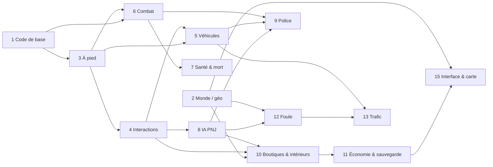

# Roadmap de développement : Gran Theft Praline

*Version anglaise : [roadmap.md](roadmap.md)*
*Créée le 2026-11-09. Revue à chaque fin de jalon (`/scope-check`, `/milestone-review`).*
*Entrées : [concept](../design/gdd/game-concept.fr.md), [stratégie de rendu](../docs/rendering/rendering-strategy.fr.md),
[ADR-0001](../docs/adr/adr-0001-rendering-pipeline.fr.md), [ADR-0002](../docs/adr/adr-0002-performance-budget.fr.md),
[recensement des assets](../docs/sourcing/asset-sourcing.fr.md).*

---

## 1. Où on en est (2026-11-09)

| Domaine | État |
| ---- | ---- |
| Environnement | Fait : projet UE 5.8, repo, CI « Provenance check », règles de travail |
| Concept | Fait : 8 tableaux de parité P0-P2, tranche verticale = nord de la Presqu'île (Bellecour → Terreaux) |
| Rendu | ADR-0002 accepté (30 i/s fidélité, 1080p, p95 GPU ≤ 33,3 ms sur le M1 Pro). ADR-0001 proposé jusqu'à la validation de la scène témoin |
| Scène témoin | En cours : greybox v0 de la rue de la République issu de la BD TOPO IGN, 4 éclairages, scripts de mesure ; premiers chiffres en cours sur le Mac |
| Code gameplay | Aucun pour l'instant. Le projet devient C++ à la première classe |
| Contenu | Rien au-delà du greybox |

En bref : **les fondations sont posées, rien n'est encore jouable**. Les
prochains mois transforment le concept en prototype de maniabilité jouable,
puis en un quartier en qualité finale.

---

## 2. Principes qui fixent l'ordre

1. **Réutiliser avant d'écrire.** Chaque système part d'un framework ou d'un
   exemple Epic gratuit quand il existe (voir le [recensement](../docs/sourcing/asset-sourcing.fr.md)).
   On n'écrit notre code que là où rien ne convient à Lyon ou au M1 Pro.
2. **La sensation avant le contenu** (pilier 1). Marcher, conduire et tirer
   se règlent en greybox avant toute production d'art final.
3. **Des systèmes plutôt que des scripts** (pilier 4). Police, foule, trafic
   et boutiques fonctionnent partout dans le quartier.
4. **Mesuré, pas deviné.** Chaque jalon se termine par des captures et des
   chiffres face à l'ADR-0002 ; rien n'arrive sur `next` sans eux.
5. **Un quartier en qualité complète** avant toute extension.
6. **Greybox issu des vraies données géo dès le premier jour**, pour régler
   le gameplay sur les vraies largeurs de rues, tailles d'îlots et distances.

---

## 3. Phases et jalons

```
2026-11            2027-01        2027-03                       2028-01~2028-05        2028+
  |  Phase 0         |  Phase 1     |  Phase 2 : tranche verticale |  Phase 3 : extension
  |  Fondations      |  MVP         |  2A systèmes 2B art 2C polish|  alpha, nouveaux quartiers
  M0 Scène témoin    M1 Maniabilité M2A Systèmes P0  M2B Quartier  M2C Tranche verticale
     validée            jouable        en greybox       habillé       livrée en interne
```

Les dates supposent le modèle d'effort de la section 6. Elles sont
replanifiées à chaque revue de jalon.

### Phase 0 : fondations (maintenant → mi-décembre 2026, environ 5 semaines)

Objectif : tout ce dont le MVP a besoin avant d'écrire du gameplay.

| Livrable | Détail | Fil |
| ---- | ---- | ---- |
| Scène témoin mesurée | 4 éclairages, profileur CSV, images Movie Render Queue ; ADR-0001 accepté ou amendé | « Atteindre le photoréalisme graphique » (en cours) |
| Pipeline géo v1 | `extract_bbox.py` étendu à tout le quartier : bâtiments et routes BD TOPO, terrain et quais LiDAR HD, types de commerces et mobilier urbain OSM ; une commande, reproductible | Reproduction de la ville |
| ADR d'architecture gameplay | ADR-0003 déplacement du personnage (CharacterMovementComponent + Game Animation Sample, Mover reporté), ADR-0004 framework gameplay (Gameplay Ability System, Enhanced Input, StateTree), ADR-0005 streaming du monde (taille des cellules World Partition, HLOD, data layers pour les intérieurs) | Socle gameplay |
| Carte des systèmes | `/map-systems` : les tableaux de parité transformés en liste de systèmes avec dépendances (la section 4 en est le premier jet) | Socle gameplay |
| Art bible v1 | `/art-bible` : références façades, sols, signalétique et lumière de la Presqu'île ; charte couleur et protocole photo | Photoréalisme |
| Hygiène du repo | Règles Git LFS pour `.uasset`/`.umap`, quota LFS vérifié, contenu éditeur seul hors Git | Socle gameplay |

**M0 « Scène témoin validée »** : p95 GPU ≤ 33,3 ms dans les quatre
éclairages sur le M1 Pro (ou budget amendé par décision de Nico), ADR-0001
accepté, les trois ADR ci-dessus écrits.

### Phase 1 : MVP, prototype de maniabilité (mi-décembre 2026 → début mars 2027, environ 10 à 12 semaines)

Objectif : tester l'hypothèse centrale du concept : notre maniabilité atteint
la sensation de la référence sur un vrai pâté de maisons lyonnais.

Périmètre (identique au MVP du concept) :

1. Un îlot du quartier en greybox issu des vraies données géo (rue de la
   République entre la place de la République et la place des Cordeliers,
   avec le quai du Rhône pour la conduite).
2. Déplacement à pied et caméra au niveau visé (motion matching du Game
   Animation Sample, caméra troisième personne avec changement d'épaule,
   enjamber et escalader les obstacles bas).
3. Une voiture à conduite physique avec dégâts (Chaos Vehicles), monter,
   descendre, voler une voiture garée.
4. Un pistolet avec couverture et corps à corps (Gameplay Ability System).
5. Une boutique où l'on entre et que l'on peut braquer ; niveaux de
   recherche 1 et 2 (signalement par témoins, voiture de patrouille,
   poursuite à pied, zone de recherche, fuite).

Hors MVP : art final, foule et trafic en densité, téléphone,
personnalisation, histoire.

Ordre dans la phase (chaque étape est jouable avant la suivante) : code de
base → à pied → interactions → voiture → pistolet, corps à corps et
couverture → santé et mort → intérieur de boutique et braquage → police
niveaux 1-2 → HUD minimal.

**M1 « Maniabilité jouable »** : une boucle de 10 minutes (marcher, voler une
voiture, rouler sur le quai, braquer la boutique, semer la police)
enregistrée en vidéo, à 30 i/s en greybox, et un rapport de playtest
(`/playtest-report`) qui note chaque verbe face à la référence.

### Phase 2 : tranche verticale (mars 2027 → début ou mi-2028, environ 12 à 15 mois)

Objectif : tout le nord de la Presqu'île en qualité finale avec toutes les
fonctions P0 du concept. Cible de contenu du concept : environ 30 boutiques
sur 5 types, 3 planques, 10 bâtiments accessibles, 6 types de véhicules,
6 armes, recherche niveaux 1 à 3, 6 activités libres.

Découpée en trois sous-phases pour que systèmes et art avancent en parallèle
sans se bloquer :

| Sous-phase | Durée | Contenu | Jalon de sortie |
| ---- | ---- | ---- | ---- |
| **2A Systèmes en greybox** | environ 5 mois | Tous les systèmes P0 sur tout le quartier en greybox : foule, trafic, police niveaux 1-3, 5 types de boutiques, planques, sauvegarde, carte et GPS avec vrais noms de rues, argent, jour/nuit et météo, jeu d'armes complet, deux-roues, accessibilité de base | **M2A « Systèmes P0 complets »** : chaque ligne P0 du concept cochée en greybox, performance dans le budget avec foule et trafic |
| **2B Quartier en qualité finale** | environ 5 mois (l'art démarre pendant 2A) | Kit de façades v2 pour les typologies de la Presqu'île, monuments (Hôtel de Ville, Opéra, Bellecour et sa statue, ponts), sols, habillage, végétation, intérieurs de boutiques en kits, enseignes fictives, population MetaHuman, véhicules | **M2B « Quartier habillé »** : les quatre éclairages de la scène témoin tiennent sur tout le quartier ; grille visuelle ≥ 4/5 face aux photos |
| **2C Finition et performance** | 2 à 3 mois | Réglage des sensations, passe audio, saccades, mémoire, bugs, étude du mode performance (60 i/s) | **M2C « Tranche verticale »** : une heure de jeu libre sans bloquant, budget tenu, revue de parité face à la référence |

### Phase 3 : extension (à partir de 2028)

Objectif : l'alpha. Fonctions P1 du concept (téléphone, personnalisation,
garages, nage, armes de jet, améliorations à l'armurerie, bars et salle de
sport), l'histoire écrite avec Nico, et de nouveaux quartiers.

Ordre de quartiers proposé, chacun réutilisant les kits des précédents :

1. Sud de la Presqu'île (Bellecour → Perrache) : mêmes typologies, le moins cher.
2. Vieux-Lyon et les berges de Saône : kit Renaissance, ruelles piétonnes,
   funiculaire en décor.
3. Pentes de la Croix-Rousse : escaliers, traboules, conduite en pente.
4. Rive gauche (Cordeliers → Part-Dieu) : boulevards, tours modernes.
5. Colline de Fourvière : monument et ligne d'horizon.

Chaque quartier est un mini-projet avec son extraction géo, ses ajouts aux
kits, ses monuments, son habillage et sa passe de performance. Estimation
après le premier : **4 à 6 mois par quartier** de taille comparable, en
baisse à mesure que les kits mûrissent. Chaque nouveau quartier est une
décision de Nico (carte), après un `/scope-check`.

---

## 4. Systèmes : ordre de développement et dépendances

| # | Système | Dépend de | Point de départ (gratuit sauf mention) | Phase | Effort |
| ---- | ---- | ---- | ---- | ---- | ---- |
| 1 | Code de base : game mode, player controller, Enhanced Input, mise en place du Gameplay Ability System, outils de debug, squelette de sauvegarde | rien | Modèles Epic, Lyra comme lecture | 0-1 | 2 semaines |
| 2 | Monde et streaming : World Partition, HLOD, data layers, import géo | pipeline géo | Notre `extract_bbox.py`, PCG | 0-1 puis 2 | 3 semaines, puis continu |
| 3 | Déplacement à pied et caméra | 1 | Game Animation Sample (motion matching, CharacterMovementComponent) | 1 | 3 semaines |
| 4 | Interactions contextuelles (portes, ramasser, s'asseoir, contenants) | 3 | Smart Objects, Gameplay Interaction | 1 | 2 semaines |
| 5 | Véhicules : voiture Chaos, animations monter/descendre, carjacking, dégâts, vitres | 3, 4 | Chaos Vehicles, véhicules de City Sample comme référence de réglage | 1 puis 2A | 4 + 4 semaines |
| 6 | Armes et combat : pistolet, corps à corps, couverture, réactions aux impacts, roue d'armes, inventaire | 1, 3 | Gameplay Ability System, modèles d'armes de Lyra | 1 puis 2A | 4 + 5 semaines |
| 7 | Santé, armure, mort, arrestation, réapparition | 6 | Attributs du Gameplay Ability System | 1 | 1 semaine |
| 8 | Base IA des PNJ : perception, comportements StateTree, réactions à la violence | 1, 4 | StateTree, AI Perception, Smart Objects | 1 puis 2A | 3 semaines + continu |
| 9 | Police et recherche : témoins, niveaux 1-3, zone de recherche, poursuites à pied et en voiture, barrages | 5, 6, 8 | Système maison sur StateTree (aucun plugin maintenu ne convient) | 1 puis 2A | 3 + 6 semaines |
| 10 | Boutiques et intérieurs : intérieurs sans chargement, 5 types, braquage, achats | 2, 4, 8 | Level Instances et data layers, kits d'intérieurs | 1 puis 2A-2B | 2 + 8 semaines |
| 11 | Économie, planques, sauvegarde | 7, 10 | Save Game, données maison | 2A | 3 semaines |
| 12 | Foule : piétons denses, emplois du temps, réactions | 8, 2 | Mass Entity et MassCrowd (5.8), LOD de foule MetaHuman ; repli : acteurs en pool | 2A | 8 semaines |
| 13 | Trafic : voies, feux, passages piétons, réactions | 5, 12 | Mass ou voies en splines issues des routes géo ; City Traffic Pro à tester | 2A | 8 semaines |
| 14 | Heure et météo | pile de rendu | SunPosition, Sky Atmosphere, Volumetric Clouds, contrôleur de la scène témoin | 0 puis 2A | 2 semaines |
| 15 | Interface : HUD, mini-carte, carte et GPS avec vrais noms, menus, accessibilité | 2, 11 | UMG, Common UI ; tuiles de carte issues de nos données géo | 1 (minimal) puis 2A | 6 semaines |
| 16 | Audio : pas, véhicules, armes, ambiance urbaine, réverbération par rue, radio plus tard | 3, 5, 6 | MetaSounds, bundles Sonniss GDC, prises de son à Lyon | continu dès la phase 1 | 6 semaines étalées |
| 17 | Deux-roues (scooter, moto, vélo) | 5 | Chaos Vehicles en configuration deux roues | 2A | 4 semaines |

Graphe de dépendances (systèmes dans l'ordre où ils deviennent jouables) :



L'audio (16), l'heure et la météo (14) et les deux-roues (17) se greffent au
graphe sans le bloquer.

---

## 5. Production de contenu (en parallèle des systèmes)

| Flux | Phases 0-1 | Phase 2 |
| ---- | ---- | ---- |
| Données géo | Greybox de l'îlot, puis de tout le quartier | Terrain final, quais, berges, routes avec bordures, noms de rues pour la carte |
| Façades | Kit v1 de la scène témoin (8 à 12 modules) | Kit v2 couvrant les typologies du quartier, trim sheets issues de nos photos |
| Monuments | Volumes de travail | Hôtel de Ville, Opéra, Bellecour, ponts en qualité finale |
| Sols et habillage | Surfaces Megascans, quelques objets | Habillage complet par PCG, enseignes fictives |
| Personnages | Mannequin du Game Animation Sample | Population et police MetaHuman, visages fictifs |
| Véhicules | Une voiture greybox | 6 types de véhicules fictifs, voiture de police |
| Intérieurs | Une boutique greybox | 5 kits de boutiques, planques, halls, parking |
| Audio | Bibliothèque provisoire | Prises de son à Lyon, mixage |

Des journées photo à Lyon (Nico ou toute personne sur place) sont
nécessaires en phase 0 (rue témoin), au début de la phase 2 (tout le
quartier) et pour chaque monument.

---

## 6. Estimation de l'effort

### Modèle d'équipe

- **Un humain, Nico** : décisions, playtests des sensations, photos de
  terrain à Lyon, validation finale. Disponibilité supposée : environ
  10 heures par semaine.
- **Production assistée par IA** : code, automatisation Python de
  l'éditeur, scripts géo, documentation, mesures et captures sur le Mac de
  développement, outils génératifs pour enseignes, décalques et volumes de
  travail.

### Où passe vraiment le temps

Le goulot n'est pas l'écriture du code. C'est :

1. **Le réglage des sensations**, qui demande un humain qui joue et juge
   (maniabilité, caméra, conduite, tir).
2. **La production d'art en qualité finale** : kits de façades, monuments,
   intérieurs, véhicules, habillage. Même avec Megascans, Fab et les outils
   génératifs, chaque asset principal demande un nettoyage dans Blender et
   un étalonnage.
3. **L'itération sur un seul Mac de 16 Go** : sessions d'éditeur,
   compilation des shaders, packaging et mesures se font en série.

### Estimation

| Phase | Durée | Confiance |
| ---- | ---- | ---- |
| Phase 0 Fondations | environ 5 semaines | Haute |
| Phase 1 MVP | 10 à 12 semaines | Moyenne |
| Phase 2 Tranche verticale | 12 à 15 mois | Faible (replanifiée à M1) |
| Phase 3 par quartier | 4 à 6 mois chacun | Faible |

**Tranche verticale terminée : début à mi-2028**, soit environ 15 à 18 mois
à partir d'aujourd'hui. Le concept annonçait 9 à 12 mois pour la tranche
verticale ; ce plan plus détaillé la place **3 à 6 mois plus tard**,
surtout à cause du volume d'art (30 boutiques, 10 bâtiments, monuments) et
de l'itération sur une seule machine. Les leviers pour revenir à 12 mois
sont dans les risques ci-dessous (contenu payant, moins de boutiques, ou une
seconde machine).

---

## 7. Risques

| Risque | Probabilité | Impact | Parade |
| ---- | ---- | ---- | ---- |
| **M1 Pro, 16 Go** : mémoire de l'éditeur avec un quartier dense, pas de Nanite, foule et trafic mangent le budget | Haute | Haut | Petites cellules World Partition, HLOD dès le départ, mesure à chaque jalon, leviers Lumen Lite et densité de l'ADR-0002 ; matériel reconsidéré seulement sur blocage mesuré |
| **UE 5.8 est la dernière version majeure d'UE5** ; le travail sur UE6 a commencé | Certaine | Moyen | Rester sur les correctifs 5.8 jusqu'à la tranche verticale ; évaluer UE6 à M2C, pas avant ; garder un C++ proche des API standard |
| **Frameworks expérimentaux** : Mover expérimental, Chaos Vehicles marqué expérimental en 5.8.2, Mass refondu en 5.8, ZoneGraph en maintenance | Haute | Moyen | Prendre d'abord la voie stable (CharacterMovementComponent, véhicule à roues Chaos), isoler Mass derrière nos interfaces, garder un repli en acteurs pour la foule |
| **Lacunes des données géo** : disponibilité et dates du LiDAR HD sur Lyon à confirmer, éditions CityGML du Grand Lyon anciennes (2012-2018), licence du photomaillage à confirmer | Moyenne | Moyen | BD TOPO (déjà en place) comme colonne vertébrale ; LiDAR pour terrain et quais ; photomaillage et Google 3D Tiles en référence visuelle seulement |
| **Licences** : conditions Megascans encore changées le 2026-11-05 (gratuit désormais), plan gratuit Tripo sans droits commerciaux, conditions MetaHuman et Flux évolutives | Moyenne | Haut | Une ligne par asset dans `assets/SOURCES.md` avec la licence lue au téléchargement ; plan Tripo payant pour tout ce qui part dans le jeu ; relecture des conditions à chaque jalon |
| **Aucun contenu de jeux existants**, ni marques ni personnes réelles | Faible | Haut | Enseignes et logos générés puis vérifiés ; véhicules dessinés fictifs ; revue à chaque jalon |
| **Périmètre** : parité avec un studio de milliers de personnes | Certaine | Haut | P0 uniquement jusqu'à M2C ; `/scope-check` à chaque jalon ; réduire le nombre de boutiques avant de baisser la qualité |
| **Un seul humain, temps limité** | Haute | Haut | Tout ce qui ne demande pas Nico est fait par les fils ; décisions regroupées en cartes |
| **Taille du repo** : `.uasset` et textures dans un repo GitHub public, quota Git LFS | Moyenne | Moyen | Règles LFS avant le premier commit de contenu, quota vérifié en phase 0, sources brutes hors Git |
| **Pas de build Unreal automatique en CI** (runner Linux, pas de Mac) | Certaine | Faible | Mesures et packaging scriptés sur le Mac, résultats versionnés comme preuves |

---

## 8. Pilotage

- Chaque jalon se termine par `/milestone-review` et `/scope-check`, des
  chiffres mesurés face à l'ADR-0002 et un résumé d'une ligne pour Nico.
- Sprints de deux semaines en phases 1 et 2 (`/sprint-plan`), stories de 1 à
  2 jours.
- Les décisions structurantes (nouveau quartier, achats payants, changement
  de framework, changement de budget) sont présentées à Nico en cartes avec
  recommandation.

---

## 9. Les quatre prochaines semaines

1. Terminer et mesurer la scène témoin ; accepter ou amender l'ADR-0001.
2. Écrire l'ADR-0003 (déplacement), l'ADR-0004 (framework gameplay),
   l'ADR-0005 (streaming du monde).
3. Étendre le pipeline géo à tout le quartier (BD TOPO + LiDAR HD + OSM).
4. Ajouter des surfaces Megascans (désormais gratuites) à la scène témoin,
   inscrites dans `assets/SOURCES.md`.
5. Poser les règles Git LFS et vérifier le quota.
6. `/map-systems` à partir de la section 4, puis sprint 1 du MVP : code de
   base et déplacement à pied à partir du Game Animation Sample.
