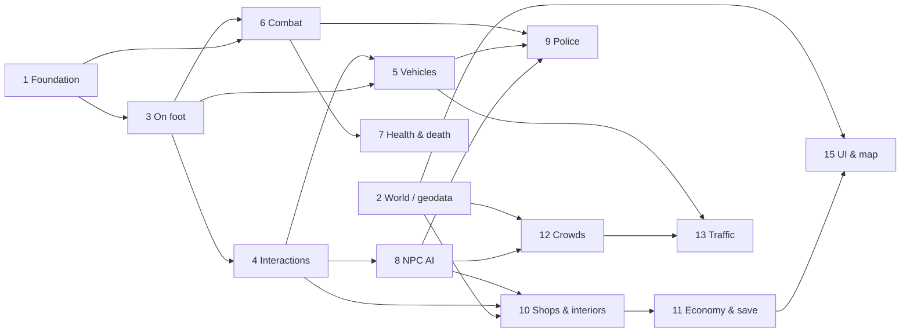

# Development roadmap: Gran Theft Praline

*French version: [roadmap.fr.md](roadmap.fr.md)*
*Created: 2026-11-09. Reviewed at the end of every milestone (`/scope-check`, `/milestone-review`).*
*Inputs: [game concept](../design/gdd/game-concept.md), [rendering strategy](../docs/rendering/rendering-strategy.md),
[ADR-0001](../docs/adr/adr-0001-rendering-pipeline.md), [ADR-0002](../docs/adr/adr-0002-performance-budget.md),
[asset sourcing survey](../docs/sourcing/asset-sourcing.md).*

---

## 1. Where we are (2026-11-09)

| Area | State |
| ---- | ---- |
| Environment | Done: UE 5.8 project, repo, CI "Provenance check", working rules |
| Concept | Done: 8 parity tables P0-P2, vertical slice = northern Presqu'île (Bellecour to Terreaux) |
| Rendering | ADR-0002 accepted (30 fps fidelity, 1080p, p95 GPU ≤ 33.3 ms on the M1 Pro). ADR-0001 proposed until the reference scene passes |
| Reference scene | In progress: greybox v0 of rue de la République built from IGN BD TOPO, 4 lighting states, benchmark scripts; first numbers being measured on the Mac |
| Gameplay code | None yet. The project becomes a C++ project with its first class |
| Content | None yet beyond the greybox |

In short: the **foundations are laid, nothing is playable yet**. The next
months turn the concept into a playable handling prototype, then into one
district at final quality.

---

## 2. Principles that drive the order

1. **Reuse before writing.** Every system starts from a free Epic framework
   or sample when one exists (see the [sourcing survey](../docs/sourcing/asset-sourcing.md)).
   We write our own code only where nothing fits Lyon or the M1 Pro.
2. **Feel before content** (Pillar 1). Moving, driving and shooting are tuned
   in greybox before any final art is produced.
3. **Systems before scripts** (Pillar 4). Police, crowds, traffic and shops are
   systems that work anywhere in the district.
4. **Measured, not guessed.** Every milestone ends with captures and numbers
   against ADR-0002; nothing reaches `next` without them.
5. **One district at full quality** before any extension.
6. **Greybox from real geodata from day one**, so gameplay is tuned on the
   real street widths, block sizes and distances.

---

## 3. Phases and milestones

```
2026-11            2027-01        2027-03                      2028-01~2028-05        2028+
  |  Phase 0         |  Phase 1     |  Phase 2: vertical slice    |  Phase 3: extension
  |  Foundations     |  MVP         |  2A systems  2B art  2C polish|  alpha, new districts
  M0 Reference       M1 Playable    M2A P0 systems  M2B District   M2C Vertical slice
     scene passed       handling       in greybox      dressed        shipped internally
```

Dates assume the effort model of section 6. They are re-planned at each
milestone review.

### Phase 0: Foundations (now to mid-December 2026, about 5 weeks)

Goal: everything the MVP needs before writing gameplay.

| Deliverable | Detail | Owner thread |
| ---- | ---- | ---- |
| Reference scene measured | 4 lighting states, CSV profiler, Movie Render Queue stills; ADR-0001 accepted or amended | "Reach graphic photorealism" (in progress) |
| Geodata pipeline v1 | `extract_bbox.py` extended to the whole district: BD TOPO buildings and roads, LiDAR HD terrain and quays, OSM shop types and street furniture points; one command, reproducible | City reproduction |
| Gameplay architecture ADRs | ADR-0003 character movement (CharacterMovementComponent + Game Animation Sample, Mover deferred), ADR-0004 gameplay framework (Gameplay Ability System, Enhanced Input, StateTree), ADR-0005 world streaming (World Partition cell size, HLOD, data layers for interiors) | Gameplay foundations |
| Systems map | `/map-systems`: the parity tables turned into a system list with dependencies (section 4 below is the first draft) | Gameplay foundations |
| Art bible v1 | `/art-bible`: references for Presqu'île façades, ground, signage, light; colour checker and photo protocol | Photorealism |
| Repository hygiene | Git LFS rules for `.uasset`/`.umap`, LFS quota checked, editor-only content kept out of Git | Gameplay foundations |

**M0 "Reference scene passed"**: p95 GPU ≤ 33.3 ms in all four states on the
M1 Pro (or an amended budget decided by the project lead), ADR-0001 accepted,
three ADRs above written.

### Phase 1: MVP, handling prototype (mid-December 2026 to early March 2027, about 10 to 12 weeks)

Goal: test the core hypothesis of the concept: our handling reaches the
benchmark's feel on a real Lyon block.

Scope (unchanged from the concept MVP):

1. One greybox block of the district from real geodata (rue de la
   République between Place de la République and Place des Cordeliers, with
   the Rhône quay for driving).
2. On-foot movement and camera at target feel (Game Animation Sample
   motion matching, third-person camera with shoulder swap, vault and climb of
   low obstacles).
3. One car with physics-based handling and damage (Chaos Vehicles), enter,
   exit, steal a parked car.
4. One pistol with cover and melee (Gameplay Ability System).
5. One enterable shop that can be robbed; heat levels 1 and 2 (witness
   reports, patrol car, foot pursuit, search zone, escape).

Not in MVP: final art, crowds and traffic at density, phone, customisation,
story.

Order inside the phase (each step is playable before the next starts):
foundation code → on foot → interaction → car → pistol, melee and cover →
health and death → shop interior and robbery → police heat 1-2 → minimal HUD.

**M1 "Playable handling"**: a 10-minute loop (walk, steal a car, drive the
quay, rob the shop, escape the police) recorded on video, holding 30 fps in
greybox, and a playtest report (`/playtest-report`) scoring each verb against
the benchmark.

### Phase 2: vertical slice (March 2027 to early or mid-2028, about 12 to 15 months)

Goal: the whole northern Presqu'île at final quality with every P0 feature of
the concept. Content target from the concept: about 30 enterable shops across
5 types, 3 safehouses, 10 enterable buildings, 6 vehicle types, 6 weapons,
heat 1 to 3, 6 sandbox activities.

Split into three sub-phases so that systems and art progress in parallel
without blocking each other:

| Sub-phase | Duration | Content | Exit milestone |
| ---- | ---- | ---- | ---- |
| **2A Systems in greybox** | about 5 months | Every P0 system on the whole district in greybox: crowds, traffic, police heat 1-3, 5 shop types, safehouses, save and load, map and GPS with real street names, money, day/night and weather, full weapon set, two-wheelers, accessibility basics | **M2A "P0 systems complete"**: every P0 row of the concept ticked in greybox, performance within budget with crowds and traffic |
| **2B District at final quality** | about 5 months (art starts during 2A) | Façade kit v2 for Presqu'île typologies, landmarks (Hôtel de Ville, Opéra, Bellecour and its statue, bridges), ground, street dressing, vegetation, shop interiors from kits, fictional signage, MetaHuman population, vehicles | **M2B "District dressed"**: the four lighting states of the reference scene hold across the district; visual checklist ≥ 4/5 against photos |
| **2C Polish and performance** | 2 to 3 months | Feel tuning, audio pass, hitches, memory, bugs, performance mode study (60 fps) | **M2C "Vertical slice"**: one hour of free play without blocker, budget held, parity review against the benchmark |

### Phase 3: extension (from 2028)

Goal: alpha. P1 features of the concept (phone, customisation, garages,
swimming, throwables, weapon shop upgrades, bars and gym), the story written
with the project lead, and new districts.

Suggested district order, each one re-using the kits of the previous ones:

1. Southern Presqu'île (Bellecour to Perrache): same typologies, cheapest.
2. Vieux-Lyon and the Saône banks: Renaissance kit, pedestrian alleys,
   funicular as scenery.
3. Croix-Rousse slopes: stairs, traboules, steep driving.
4. Rive gauche (Cordeliers to Part-Dieu): boulevards, modern towers.
5. Fourvière hill: landmark and skyline.

Each district is a mini-project with its own geodata extraction, kit
additions, landmarks, dressing and performance pass. Estimate after the first
one: **4 to 6 months per district** of comparable size, falling as the kits
mature. Every new district is a decision for the project lead (card), after a
`/scope-check`.

---

## 4. Systems: development order and dependencies

| # | System | Depends on | Starting point (free unless noted) | Phase | Effort |
| ---- | ---- | ---- | ---- | ---- | ---- |
| 1 | Foundation code: game mode, player controller, Enhanced Input, Gameplay Ability System setup, debug tools, save skeleton | none | Epic templates, Lyra as reading reference | 0-1 | 2 weeks |
| 2 | World and streaming: World Partition, HLOD, data layers, geodata import | geodata pipeline | Our `extract_bbox.py`, PCG | 0-1 then 2 | 3 weeks, then continuous |
| 3 | On-foot locomotion and camera | 1 | Game Animation Sample (motion matching, CharacterMovementComponent) | 1 | 3 weeks |
| 4 | Contextual interactions (doors, pick up, sit, containers) | 3 | Smart Objects, Gameplay Interaction | 1 | 2 weeks |
| 5 | Vehicles: Chaos car, enter and exit animations, carjack, damage, glass | 3, 4 | Chaos Vehicles, City Sample vehicles as tuning reference | 1 then 2A | 4 weeks + 4 weeks |
| 6 | Weapons and combat: pistol, melee, cover, hit reactions, weapon wheel, inventory | 1, 3 | Gameplay Ability System, Lyra weapon patterns | 1 then 2A | 4 weeks + 5 weeks |
| 7 | Health, armour, death, arrest, respawn | 6 | Gameplay Ability System attributes | 1 | 1 week |
| 8 | NPC AI base: perception, StateTree behaviours, reactions to violence | 1, 4 | StateTree, AI Perception, Smart Objects | 1 then 2A | 3 weeks + continuous |
| 9 | Police and wanted system: witnesses, heat 1-3, search zone, pursuit on foot and by car, roadblocks | 5, 6, 8 | Own system on StateTree (no maintained plugin fits) | 1 then 2A | 3 weeks + 6 weeks |
| 10 | Shops and interiors: seamless interiors, 5 shop types, robbery, buying | 2, 4, 8 | Level Instances and data layers, interior kits | 1 then 2A-2B | 2 weeks + 8 weeks |
| 11 | Economy, safehouses, save and load | 7, 10 | Save Game, own data | 2A | 3 weeks |
| 12 | Crowds: dense pedestrians, schedules, reactions | 8, 2 | Mass Entity and MassCrowd (5.8), MetaHuman crowd LODs; fallback: pooled actors | 2A | 8 weeks |
| 13 | Traffic: lanes, lights, crossings, reactions | 5, 12 | Mass or spline lanes from geodata roads; City Traffic Pro to test | 2A | 8 weeks |
| 14 | Time of day and weather | rendering stack | SunPosition, Sky Atmosphere, Volumetric Clouds, reference scene controller | 0 then 2A | 2 weeks |
| 15 | UI: HUD, mini-map, map and GPS with real names, menus, accessibility | 2, 11 | UMG, Common UI; map tiles from our geodata | 1 (minimal) then 2A | 6 weeks |
| 16 | Audio: footsteps, vehicles, weapons, city ambience, reverb by street, radio later | 3, 5, 6 | MetaSounds, Sonniss GDC bundles, Lyon field recordings | continuous from 1 | 6 weeks spread |
| 17 | Two-wheelers (scooter, motorbike, bicycle) | 5 | Chaos Vehicles two-wheel setup | 2A | 4 weeks |

Dependency graph (systems in the order they become playable):



Audio (16), time of day (14) and two-wheelers (17) attach to the graph without
blocking it.

---

## 5. Content pipeline (runs in parallel with the systems)

| Stream | Phase 0-1 | Phase 2 |
| ---- | ---- | ---- |
| Geodata | Block greybox, then the whole district greybox | Final terrain, quays, river banks, roads with kerbs, street-name data for the map |
| Façades | Reference scene kit v1 (8-12 modules) | Kit v2 covering the district's typologies, trim sheets from our photos |
| Landmarks | Blockouts | Hôtel de Ville, Opéra, Bellecour, bridges at final quality |
| Ground and dressing | Megascans surfaces, a few props | Full dressing with PCG, fictional signage |
| Characters | Game Animation Sample mannequin | MetaHuman population and police, fictional faces |
| Vehicles | One greybox car | 6 fictional vehicle types, police car |
| Interiors | One shop greybox | 5 shop kits, safehouses, lobbies, car park |
| Audio | Placeholder library | Field recordings in Lyon, mix |

Field photo days in Lyon (project lead or anyone on site) are needed in
Phase 0 (reference street), early Phase 2 (whole district) and for each
landmark.

---

## 6. Effort estimate

### Team model

- **One human, the project lead**: decisions, playtests of feel, field photos
  in Lyon, final validation. Assumed availability: about 10 hours a week.
- **AI-assisted production**: code, editor Python automation, geodata
  scripts, documentation, measurements and captures on the development Mac,
  generative tools for signage, decals and blockouts.

### Where the time really goes

The bottleneck is not writing code. It is:

1. **Feel tuning**, which needs a human playing and judging (handling, camera,
   driving, shooting).
2. **Art production at final quality**: façade kits, landmarks, interiors,
   vehicles, dressing. Even with Megascans, Fab and generative tools, each
   hero asset needs cleanup in Blender and calibration.
3. **Iteration on a single 16 GB Mac**: editor sessions, shader compiles,
   packaging and benchmarks are serial.

### Estimate

| Phase | Duration | Confidence |
| ---- | ---- | ---- |
| Phase 0 Foundations | about 5 weeks | High |
| Phase 1 MVP | 10 to 12 weeks | Medium |
| Phase 2 Vertical slice | 12 to 15 months | Low (re-planned at M1) |
| Phase 3 per district | 4 to 6 months each | Low |

**Vertical slice complete: early to mid-2028**, about 15 to 18 months from
now. The concept said 9 to 12 months for the vertical slice; this more
detailed plan puts it **3 to 6 months later**, mainly because of the art
volume (30 shops, 10 buildings, landmarks) and the single-machine
iteration. The levers to come back to 12 months are in the risks below
(paid content, reduced shop count, or a second machine).

---

## 7. Risks

| Risk | Probability | Impact | Mitigation |
| ---- | ---- | ---- | ---- |
| **M1 Pro, 16 GB**: editor memory with a dense district, no Nanite, crowds and traffic eat the budget | High | High | Small World Partition cells, HLOD from day one, measure at every milestone, Lumen Lite and density levers in ADR-0002; reconsider hardware only on a measured blocker |
| **UE 5.8 is the last UE5 major release**; UE6 work has started | Certain | Medium | Stay on 5.8 hotfixes until the vertical slice; evaluate UE6 at M2C, not before; keep C++ close to stock APIs |
| **Experimental frameworks**: Mover experimental, Chaos Vehicles flagged experimental in 5.8.2, Mass overhauled in 5.8, ZoneGraph in maintenance | High | Medium | Use the stable path first (CharacterMovementComponent, Chaos wheeled vehicle), isolate Mass behind our own interfaces, keep a pooled-actor fallback for crowds |
| **Geodata gaps**: LiDAR HD availability and dates to confirm on Lyon, Grand Lyon CityGML editions old (2012-2018), photomesh licence to confirm | Medium | Medium | BD TOPO (already working) as the backbone; LiDAR for terrain and quays; photomesh and Google 3D Tiles as visual reference only |
| **Licences**: Megascans terms changed again on 2026-11-05 (now free), Tripo free plan gives no commercial rights, MetaHuman and Flux terms evolve | Medium | High | One row per asset in `assets/SOURCES.md` with the licence read at download time; paid Tripo plan for anything shipped; re-check terms at each milestone |
| **No content from existing games**, no real brands or people | Low | High | Signage and logos generated then checked; vehicles designed fictional; review at each milestone |
| **Scope**: parity with a studio of thousands | Certain | High | P0 only until M2C; `/scope-check` at each milestone; cut the shop count before cutting quality |
| **Single human, limited time** | High | High | Everything that does not need the project lead is done by the threads; decisions grouped on cards |
| **Repository size**: `.uasset` and textures in a public GitHub repo, Git LFS quota | Medium | Medium | LFS rules before the first content commit, check the quota in Phase 0, keep raw sources out of Git |
| **No automated Unreal build in CI** (Linux runner, no Mac) | Certain | Low | Benchmarks and packaging scripted on the Mac, results committed as evidence |

---

## 8. Governance

- Each milestone ends with `/milestone-review` and `/scope-check`, captured
  numbers against ADR-0002, and a one-line summary to the project lead.
- Sprints of two weeks in Phase 1 and 2 (`/sprint-plan`), stories of 1 to 2
  days.
- Structural decisions (new district, paid purchases, framework changes,
  budget changes) go to the project lead as cards with a recommendation.

---

## 9. Next four weeks

1. Finish and measure the reference scene; accept or amend ADR-0001.
2. Write ADR-0003 (movement), ADR-0004 (gameplay framework), ADR-0005 (world
   streaming).
3. Extend the geodata pipeline to the whole district (BD TOPO + LiDAR HD + OSM).
4. Add Megascans surfaces (now free) to the reference scene, logged in
   `assets/SOURCES.md`.
5. Set Git LFS rules and check the quota.
6. `/map-systems` from section 4, then sprint 1 of the MVP: foundation code and
   on-foot movement from the Game Animation Sample.
