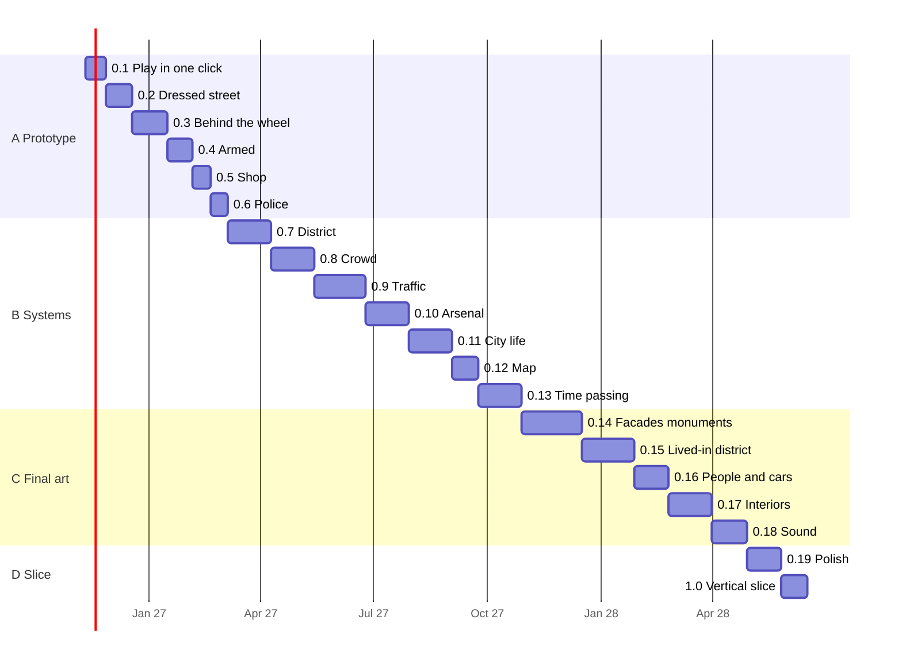

# Development roadmap: Gran Theft Praline

*French version: [roadmap.fr.md](roadmap.fr.md)*
*Version 2, 2026-11-09: roadmap split into numbered playable versions (0.1 → 1.0).*
*Day-to-day tracking: [roadmap-status.md](roadmap-status.md). Assets to generate: [asset-catalog.md](asset-catalog.md).*
*Inputs: [concept](../design/gdd/game-concept.md), [rendering strategy](../docs/rendering/rendering-strategy.md),
[ADR-0001](../docs/adr/adr-0001-rendering-pipeline.md), [ADR-0002](../docs/adr/adr-0002-performance-budget.md),
[asset sourcing survey](../docs/sourcing/asset-sourcing.md).*

---

## 1. How to read this roadmap

- The game moves forward in **playable versions**: 0.1, 0.2, 0.3… up to
  **1.0 = vertical slice** (north of the Presqu'île, Bellecour → Terreaux,
  every P0 feature of the concept at final quality).
- **Every version launches in one click** on the Mac (packaged macOS
  application) and adds something you can see or do while playing.
- Every version has the same sheet: a one-sentence **goal**, a verifiable
  **"done when"** criterion (measurement, screenshot or video), short
  **tasks**, **dependencies**, **threads** that can work in parallel,
  **assets** to generate, and an **estimate**.
- A version is finished when its criterion is verified by a measurement or
  a screenshot, CI is green and the commit has been advanced to `next`
  then `main`. The version's build is stored in
  `GTAL/Builds/<version>/` on the Mac.
- Dates are targets, reviewed at the end of every version.

### Two quality levels: photorealism first

The goal remains **photorealism**, even if the game becomes heavy in size and
in computation. The MacBook Pro M1 will therefore not run the best-looking
version at first. Every version is built with two
quality profiles, chosen in the game's options menu:

| Profile | Role | Criterion |
| ---- | ---- | ---- |
| **Ultra (photorealistic)** | The visual target: full-resolution assets, Nanite and hardware Lumen enabled where the machine allows it, uncompromised lighting and materials | Validated by captures (Movie Render Queue) compared with real photos, even if the M1 renders it at only a few frames per second |
| **M1 (playable)** | What we play day to day on the MacBook Pro M1 Pro 16 GB | 95% of frames ≤ 33.3 ms at 1080p (ADR-0002) in the packaged build |

The M1 profile is **derived** from the Ultra profile (LODs, reduced textures, lighter
software Lumen, densities) and never the other way around: we do not lower the
quality of the source assets to make the M1 keep up. The Ultra profile
will become playable on a more powerful machine the day Nico
decides so. These two levels are the ones defined in ADR-0001 and ADR-0002
(Ultra and M1 levels).

In the sheets below, "budget held" means: M1 profile within the
ADR-0002 budget, measured in the packaged build.

### The four major stages

| Stage | Versions | What we get | Target |
| ---- | ---- | ---- | ---- |
| **A. Playable prototype** | 0.1 → 0.6 | A Lyon street where you walk, drive, shoot, rob a shop and lose the police | early March 2027 |
| **B. The whole district as systems** | 0.7 → 0.13 | Bellecour → Terreaux in greybox, crowd, traffic, map, economy, weather | end of October 2027 |
| **C. District at final quality** | 0.14 → 0.18 | Façades, monuments, set dressing, population, vehicles, interiors, sound | April 2028 |
| **D. Vertical slice** | 0.19 → 1.0 | Polish, performance, one hour of play with no blocker | June 2028 |
| Afterwards | 1.x | New districts, P1 features, story written with Nico | 2028+ |

---

## 2. Where we stand (2026-11-09)

| Area | Status |
| ---- | ---- |
| Environment | Done: UE 5.8 project, repo, "Provenance check" CI, working rules |
| Concept | Done: P0-P2 parity tables, vertical slice = north of the Presqu'île |
| Rendering | ADR-0002 accepted (30 fps, 1080p, 95% of frames ≤ 33.3 ms), to be applied to the M1 profile. ADR-0001 proposed, to be amended for the Ultra profile |
| Reference scene | Greybox of rue de la République (IGN BD TOPO, 334 buildings, 367 m), 4 lighting setups. **Measured over budget: 43 to 51 ms** (GPU bound) |
| Assets | Tripo Studio Max subscription active (25,200 Studio credits), `tools/tripo/` tool in progress |
| Gameplay code | None. **Nothing is playable yet** |

---

## 3. Versions at a glance

| Version | Name | You can… | Target |
| ---- | ---- | ---- | ---- |
| **0.1** | Play in one click | launch the game with a double-click and walk, run, jump in rue de la République | 2026-11-27 |
| **0.2** | The dressed street | stroll down a photorealistic street in the Ultra profile (captures) and at 30 fps in the M1 profile, under 4 lighting setups | 2026-12-18 |
| **0.3** | Behind the wheel | steal a parked car and drive to quai du Rhône | 2027-01-15 |
| **0.4** | Armed | shoot, take cover, fight, die and respawn | 2027-02-05 |
| **0.5** | First shop | enter a shop with no loading screen, buy, rob it | 2027-02-19 |
| **0.6** | The police arrive | be wanted (levels 1-2), chased, and lose the police | 2027-03-05 |
| **0.7** | The whole district | travel Bellecour → Terreaux on foot and by car | 2027-04-09 |
| **0.8** | The crowd | pass hundreds of pedestrians who react | 2027-05-14 |
| **0.9** | Traffic | drive through traffic with lights and right of way | 2027-06-25 |
| **0.10** | The arsenal | choose among 6 weapons, face level 3 police and their roadblocks | 2027-07-30 |
| **0.11** | City life | earn and spend money in 5 types of shops, save in a safehouse | 2027-09-03 |
| **0.12** | The map | open the map of Lyon with real street names and follow the GPS | 2027-09-24 |
| **0.13** | Time passing | live through day, night and weather, ride two-wheelers, do 6 free activities | 2027-10-29 |
| **0.14** | Façades and monuments | see the district with final façades, Hôtel de Ville, Opéra, Bellecour, bridges | 2027-12-17 |
| **0.15** | The lived-in district | see sidewalks, fictional shop signs, vegetation and street furniture across the district | 2028-01-28 |
| **0.16** | People and cars | pass a realistic population and police, 6 final vehicles | 2028-02-25 |
| **0.17** | Interiors | enter 30 shops, 10 buildings, 3 safehouses at final quality | 2028-03-31 |
| **0.18** | The sound of Lyon | hear the city: footsteps, engines, weapons, ambience per street | 2028-04-28 |
| **0.19** | Polish | play for one hour with no blocker, within budget everywhere | 2028-05-26 |
| **1.0** | Vertical slice | play the complete vertical slice, parity review against the reference | 2028-06-16 |

Final art does not start at 0.14: it is **produced ahead of time** (Tripo
waves, façade kits, photos) during stages A and B, and **integrated**
in versions 0.14 to 0.17. See section 5.

---

## 4. Version details

Thread legend: each "Threads" line suggests topics that can be handed to
different threads at the same time. Threads that open the Unreal editor
on the Mac run one after another (a single editor session at a time on
16 GB); documentation, script, geo data and Tripo generation threads run
in parallel without limit.

### Stage A: playable prototype

#### 0.1 Play in one click

**Goal.** A double-click on `GranTheftPraline.app` launches the game and you
control a character in rue de la République in greybox.

**Done when:**
- `GTAL/Builds/0.1/GranTheftPraline.app` starts from a double-click in under
  30 seconds, with no editor and no terminal.
- Title screen with "Play" and "Quit", pause menu (Esc), clean return to the
  desktop.
- The character walks, runs, jumps, crouches; third-person camera
  adjustable with mouse and gamepad; collisions on every building; you
  cannot fall out of the world.
- A 2-minute video and a frame-time capture (CSV) of the packaged build are
  versioned as evidence. The 30 fps budget is **not** required in 0.1: it
  is from 0.2 onward.
- 10 minutes of play without a crash.

**Tasks:**
1. Switch the project to C++: minimal `GranTheftPraline` module, `GameMode`,
   `PlayerController`, `GameInstance`.
2. Git LFS rules for `.uasset`, `.umap` and binaries; check the quota.
3. Integrate the Game Animation Sample (character, motion matching,
   camera) into `Content/Characters/`.
4. Enhanced Input: keyboard-mouse and gamepad, actions for move, look,
   jump, sprint, crouch.
5. Turn the reference scene greybox into the playable level
   `L_RueRepublique`: collisions, PlayerStart, kill-Z, boundary volumes.
6. Title screen and pause menu (UMG).
7. Script `tools/build/package-mac.sh` (BuildCookRun, Shipping, ad hoc
   signing) that produces the application in `GTAL/Builds/<version>/`.
8. Run the build, record video, measure frame time, archive the evidence.

**Depends on:** reference scene (branch `feat/reference-scene`, to be merged).

**Parallel threads:**
- *Build and one-click launch* (tasks 1, 2, 6, 7, 8): critical path.
- *Playable character* (tasks 3, 4).
- *Playable rue de la République* (task 5, merging the reference scene).
- *Tripo wave 1*: already generates the street furniture for 0.2 (see catalog).

**Assets:** no final asset needed. Tripo wave 1 started ahead of time.

**Estimate:** 2 to 3 weeks, half an hour of Nico's time to test the build.

#### 0.2 The dressed street

**Goal.** Rue de la République looks like a real Lyon street in the
Ultra profile, and the M1 profile plays within the ADR-0002 budget.

**Done when:**
- Ultra profile: captures of the 4 lighting setups (noon, golden hour, rain,
  night) placed next to real photos of the street, judged believable by Nico.
- M1 profile: 95% of frames ≤ 33.3 ms in the packaged build, under the
  4 lighting setups, measured by CSV.
- Profile choice in the game's options menu.
- ADR-0001 amended: Ultra profile and M1 profile, with the numbers.
- Façade kit v1 (8 to 12 modules), Megascans ground, at least 40 pieces of
  street furniture from Tripo wave 1, all recorded in
  `assets/SOURCES.md`.
- In-game key to switch lighting; golden hour and night fixed.
- Screenshots compared with real photos of the street.

**Tasks:**
1. Define the two profiles (Scalability and Device Profiles); choose the
   M1 profile levers (Lumen Lite, 50% internal resolution, other) via a
   card to Nico, with numbers and Ultra / M1 comparison images.
2. Façade kit v1 (Blender + photo textures).
3. Full-resolution Megascans ground and sidewalks (cobblestones, asphalt,
   curbs), reduced variants for the M1 profile.
4. Clean up and import Tripo wave 1 (LODs, collisions, materials).
5. Fix golden hour and night exposure.
6. In-game lighting selector.
7. Full measurement and report.

**Depends on:** 0.1.

**Parallel threads:** *Reaching photorealism* (tasks 1, 5, 6, 7),
*Façade kit v1* (2, 3), *Tripo wave 1* (4).

**Assets:** Tripo wave 1, street furniture (60 models).

**Estimate:** 3 weeks.

#### 0.3 Behind the wheel

**Goal.** You steal a parked car and drive it from rue de la
République to quai du Rhône.

**Done when:**
- A fictional car with physics-based driving (Chaos Vehicles): acceleration,
  braking, handbrake, controllable drift, chase camera.
- Get in, get out, eject an NPC driver, open a parked car.
- Simple damage (deformed bodywork, broken windows).
- Greybox extended to quai du Rhône and the nearest bridge.
- Video of a 3-minute drive; 30 fps budget held while driving.

**Tasks:** ADR-0003 (movement); Smart Objects for doors and seats;
Chaos vehicle and tuning; get in/get out animations; damage; geo
extension to the quay; measurement.

**Depends on:** 0.1 (character), geo pipeline for the quay.

**Parallel threads:** *Vehicles*, *Contextual interactions*,
*City reproduction: quay and bridge*, *Tripo wave 2* (car bodies).

**Assets:** Tripo wave 2, vehicles and related street objects (30 models).

**Estimate:** 4 weeks.

#### 0.4 Armed

**Goal.** You fight: pistol, aiming, cover, melee, death
and respawn.

**Done when:**
- Pistol: aim, shoot, reload, impacts on surfaces, target
  reactions.
- Cover against walls and cars, melee (hits, dodge).
- Health, armor, death, respawn at the nearest (fictional) hospital.
- Training dummies or simple hostile NPCs.
- Video of a 2-minute fight, budget held.

**Tasks:** ADR-0004 (gameplay framework: Gameplay Ability System,
Enhanced Input, StateTree); attributes and abilities; weapon and ammo;
cover; melee; death and respawn; basic hostile NPCs.

**Depends on:** 0.1.

**Parallel threads:** *Combat and weapons*, *Health and respawn*,
*Tripo wave 3* (fictional weapons, props).

**Assets:** Tripo wave 3, weapons and props (25 models).

**Estimate:** 3 weeks.

#### 0.5 First shop

**Goal.** You enter a shop with no loading screen, buy something there
and can rob it.

**Done when:**
- A door that opens, a furnished interior loaded on the fly (Level Instance or
  data layer).
- NPC shopkeeper (StateTree) who serves, surrenders or calls the police.
- Buying an item, robbery with a cash register, money displayed.
- Video of a robbery; budget held when entering and leaving.

**Tasks:** ADR-0005 (streaming: World Partition cells, HLOD, data
layers); kit-based shop interior; NPC shopkeeper; robbery; money.

**Depends on:** 0.4 (threatening with a weapon), interactions from 0.3.

**Parallel threads:** *Shops and interiors*, *NPC AI*,
*Tripo wave 4* (shop interior).

**Assets:** Tripo wave 4, furniture and products for one shop (40 models).

**Estimate:** 2 weeks.

#### 0.6 The police arrive

**Goal.** A crime triggers a level 1 or 2 wanted status that you
can shake off.

**Done when:**
- Witnesses who report, wanted levels 1 and 2, search zone.
- Foot and car patrols, chase, arrest.
- You lose the police by leaving the zone or hiding.
- Minimal HUD: health, money, wanted level, weapon.
- **"Playable handling" milestone**: a 10-minute loop (walk, steal
  a car, drive along the quay, rob the shop, lose the police)
  recorded on video, budget held, playtest report rating each verb against the
  reference.

**Tasks:** NPC perception; wanted system; police AI
(StateTree) on foot and by car; HUD; Nico's playtest.

**Depends on:** 0.3, 0.4, 0.5.

**Parallel threads:** *Police and wanted*, *Interface*, *Tripo wave 5*
(fictional police equipment).

**Assets:** Tripo wave 5, fictional police and signage (20 models).

**Estimate:** 3 weeks, one hour of playtesting by Nico.

### Stage B: the whole district as systems (greybox)

#### 0.7 The whole district

**Goal.** You travel all of Bellecour → Terreaux, quays and bridges included,
with no loading and within budget.

**Done when:** geo pipeline v1 (BD TOPO, LiDAR HD, OSM) that produces the
district in one command; World Partition and HLOD; Bellecour →
Terreaux trip on foot and by car recorded on video; 95% of frames ≤ 33.3 ms on the
trip; memory ≤ 9 GB GPU.

**Threads:** *City reproduction* (geo pipeline), *World streaming*,
*Façade kit v2* (starts, integrated in 0.14).

**Assets:** Tripo wave 6, furniture for the squares (Bellecour, Terreaux,
Jacobins, République) (50 models).

**Estimate:** 5 weeks.

#### 0.8 The crowd

**Goal.** Hundreds of pedestrians live in the district and react
to the player.

**Done when:** Mass crowd (MassCrowd) on sidewalks and squares, adjustable
density, fleeing from weapons, budget held at target density; actor
fallback tested.

**Threads:** *Crowd*, *NPC AI*, *Tripo wave 7* (carried objects, pedestrian
props).

**Assets:** Tripo wave 7 (30 models).

**Estimate:** 5 weeks.

#### 0.9 Traffic

**Goal.** Believable traffic: lanes derived from the real streets,
lights, right of way, reactions to accidents.

**Done when:** lane network generated from the geo data, traffic lights and
pedestrian crossings, cars that avoid, honk, flee; budget held.

**Threads:** *Traffic*, *City reproduction* (lanes and lights),
*Tripo wave 8* (lights, generic signs, road furniture).

**Assets:** Tripo wave 8 (40 models).

**Estimate:** 6 weeks.

#### 0.10 The arsenal

**Goal.** Complete combat: 6 weapons, weapon wheel, inventory, level 3
police with roadblocks.

**Done when:** 6 tuned fictional weapons, weapon wheel, impact
reactions, level 3, roadblocks, car chases.

**Threads:** *Combat and weapons*, *Police and wanted*, *Tripo wave 9*.

**Assets:** Tripo wave 9, weapons and equipment (30 models).

**Estimate:** 5 weeks.

#### 0.11 City life

**Goal.** An economy: 5 types of shops, purchases, safehouses,
saving.

**Done when:** 5 playable shop types (grocery, clothing,
gun shop, garage, bar or café), 3 safehouses, reliable save and load,
persistent money.

**Threads:** *Shops and interiors*, *Economy and saving*,
*Tripo waves 10 and 11* (interiors per shop type).

**Assets:** Tripo waves 10-11, interiors (120 models).

**Estimate:** 5 weeks.

#### 0.12 The map

**Goal.** Map and minimap of Lyon with real street names, GPS,
complete menus.

**Done when:** map tiles derived from our geo data, GPS that follows
traffic directions, options menus and basic accessibility (subtitles,
remapping, color blindness).

**Threads:** *Interface and map*, *City reproduction* (tiles, names).

**Estimate:** 3 weeks.

#### 0.13 Time passing

**Goal.** Dynamic day, night and weather, two-wheelers, free activities.

**Done when:** day-night cycle and weather that hold the budget, scooter,
motorbike and bicycle, the concept's 6 free activities; **"P0 systems
complete" milestone**: every P0 line of the concept checked off in greybox.

**Threads:** *Time and weather*, *Vehicles (two-wheelers)*, *Activities*,
*Tripo wave 12* (two-wheelers, activity furniture).

**Assets:** Tripo wave 12 (30 models).

**Estimate:** 5 weeks.

### Stage C: district at final quality

The assets for this stage are produced during A and B; these versions
integrate, tune and measure them.

| Version | Done when | Threads | Assets |
| ---- | ---- | ---- | ---- |
| **0.14 Façades and monuments** | Façade kit v2 across the whole district; Hôtel de Ville, Opéra, place Bellecour and its statue, bridges at final quality; Ultra captures of the 4 lighting setups, M1 profile within budget across the whole district | *Façade kit v2*, *Monuments*, *Photorealism* | Field photos, Blender; Tripo for decorative elements (wave 13, 60 models) |
| **0.15 The lived-in district** | PCG set dressing (furniture, vegetation, generated and checked fictional shop signs) across the whole district; visual grid ≥ 4/5 against the photos | *PCG set dressing*, *Fictional shop signs* | Wave 14, vegetation, shopfronts, details (80 models) |
| **0.16 People and cars** | MetaHuman population and police (fictional faces), 6 final fictional vehicles, police car | *Characters*, *Final vehicles* | Wave 15, final car bodies and character accessories (40 models) |
| **0.17 Interiors** | 30 shops, 10 accessible buildings, 3 safehouses, lobby and parking garage at final quality | *Interiors* | Waves 16-17, final interior furniture (150 models) |
| **0.18 The sound of Lyon** | Footsteps per surface, engines, weapons, ambience per street, reverb; field recordings in Lyon | *Audio* | Free libraries + field recordings |

### Stage D: vertical slice

| Version | Done when | Threads |
| ---- | ---- | ---- |
| **0.19 Polish** | Hitches, memory, bugs; one hour of free play with no blocker in the M1 profile; budget held everywhere; Ultra captures of the whole district; study of a 60 fps mode | *Performance*, *Quality*, *Game feel* (Nico's playtests) |
| **1.0 Vertical slice** | Line-by-line parity review against the reference; showcase video; Nico's decision on what comes next (next district, story) | *Parity review*, *Showcase* |

### After 1.0

1.x versions: one district at a time (south of the Presqu'île, Vieux-Lyon,
slopes of the Croix-Rousse, left bank, Fourvière), P1 features of the concept
(phone, customization, garages, swimming…) and the story written with
Nico. About 4 to 6 months per district, each one decided by Nico.

---

## 5. Asset production with Tripo

The Tripo Studio Max subscription (25,200 Studio credits, spent only
in the Studio web interface) is used **continuously, ahead of
integration**: each version has its wave of models listed in the
[catalog](asset-catalog.md).

- **What Tripo does well here:** isolated small to medium-sized objects
  (street furniture, props, interior furniture, products, weapons,
  car body drafts, decorative elements).
- **What we do not hand to it:** façades and buildings (modular kits and
  geo data), terrain, playable characters (MetaHuman), complete
  monuments (photos and Blender; Tripo only for ornaments).
- **Flow:** catalog → reference images (Flux, GPT Image) when
  useful → dozens of parallel generations in Studio → GLB export to
  `assets/tripo/<wave>/` → Blender cleanup (scale, pivot, LODs,
  collisions) → Unreal import → line in `assets/SOURCES.md` → status in
  the catalog.
- **Master and light variant:** every model is kept as a **high-quality
  master** (generation and textures at maximum resolution, original GLB
  kept) and derived into a **light variant** (reduced polygons and
  textures) for the M1 profile. In Unreal, the master serves the Ultra profile
  (Nanite enabled when the machine allows it) and the light variant serves the
  M1 profile LODs.
- **Storage:** master GLBs are heavy and stay **out of Git**. The
  repo only contains the integrated Unreal assets (Git LFS) and the
  catalog. Where to store the masters (external drive, online storage,
  unversioned `GTAL/AssetsMaster/` folder in the meantime) is a decision
  for Nico to make before the end of wave 1.
- **Target pace:** one wave of 20 to 60 models every two to three
  weeks, about 800 models by 0.17. The actual credit cost
  per model is measured on wave 1 and the pace adjusted to use up
  the credits before they expire.
- **Safeguards:** no brands, no real logos, no object copied from an
  existing game; every model goes through a visual review before entering
  the game.

---

## 6. Systems, versions and dependencies

| # | System | Version | Depends on | Starting point |
| ---- | ---- | ---- | ---- | ---- |
| 1 | Core code (game mode, Enhanced Input, debug, packaging) | 0.1 | nothing | Epic templates, Lyra for reference |
| 2 | World and streaming (World Partition, HLOD, data layers, geo import) | 0.1, 0.5, 0.7 | geo pipeline | `extract_bbox.py`, PCG |
| 3 | On foot and camera | 0.1 | 1 | Game Animation Sample |
| 4 | Contextual interactions | 0.3 | 3 | Smart Objects, Gameplay Interaction |
| 5 | Vehicles | 0.3, 0.13, 0.16 | 3, 4 | Chaos Vehicles |
| 6 | Weapons and combat | 0.4, 0.10 | 1, 3 | Gameplay Ability System |
| 7 | Health, death, respawn | 0.4 | 6 | GAS attributes |
| 8 | NPC AI | 0.5, 0.8 | 1, 4 | StateTree, AI Perception, Smart Objects |
| 9 | Police and wanted | 0.6, 0.10 | 5, 6, 8 | In-house system on StateTree |
| 10 | Shops and interiors | 0.5, 0.11, 0.17 | 2, 4, 8 | Level Instances, data layers |
| 11 | Economy, safehouses, saving | 0.11 | 7, 10 | Save Game |
| 12 | Crowd | 0.8 | 2, 8 | Mass, MassCrowd; actor fallback |
| 13 | Traffic | 0.9 | 5, 12 | Mass or splines derived from geo roads |
| 14 | Time and weather | 0.2, 0.13 | rendering | SunPosition, Sky Atmosphere, reference scene controller |
| 15 | Interface, map, GPS | 0.1, 0.6, 0.12 | 2, 11 | UMG, Common UI |
| 16 | Audio | ongoing, 0.18 | 3, 5, 6 | MetaSounds |
| 17 | Two-wheelers | 0.13 | 5 | Chaos Vehicles |

*Decided by Nico on 2026-11-09: gameplay foundation built on free Epic
building blocks (Game Animation Sample, Gameplay Ability System, Chaos Vehicles,
StateTree, Mass); police and shops written by us.*

---

## 7. Effort and team

- **Nico** (about 10 h per week): decisions via cards, game feel playtests
  at every version (half an hour to an hour), field photos
  in Lyon (reference street, then district, then monuments).
- **AI-assisted production**: code, scripts, geo data, asset generation and
  cleanup, measurements and captures on the Mac, documentation.
- **Bottlenecks:** game feel tuning (needs Nico), volume of final art,
  a single 16 GB Mac (editor, shaders, packaging and measurements in series).

| Stage | Duration | Confidence |
| ---- | ---- | ---- |
| A Prototype (0.1-0.6) | about 16 weeks | Medium |
| B Systems (0.7-0.13) | about 8 months | Low, replanned at 0.6 |
| C Final art (0.14-0.18) | about 6 months | Low |
| D Slice (0.19-1.0) | about 7 weeks | Low |

---

## 8. Risks

| Risk | Likelihood | Impact | Mitigation |
| ---- | ---- | ---- | ---- |
| **M1 Pro, 16 GB**: already over budget in greybox (43-51 ms), no Nanite | Certain | High | Two profiles: the M1 plays a reduced profile, photorealism is carried by the Ultra profile; levers chosen in 0.2, measurement at every version, HLOD and small cells from 0.7 |
| **Size of the game and sources** (high-quality masters, 4K-8K textures) | High | Medium | Masters out of Git, storage decided before the end of wave 1, packaging per profile |
| **Ultra profile not verifiable in real time** on the M1 | Certain | Medium | Validation via Movie Render Queue captures; test on a more powerful machine when Nico decides so |
| **A single editor session** at a time on the Mac | Certain | Medium | Editor threads queued; docs, geo and Tripo threads in parallel; headless scripts when possible |
| **UE 5.8 is the last major UE5 release** | Certain | Medium | Stay on 5.8 until 1.0 |
| **Experimental frameworks** (Mover, Chaos Vehicles 5.8.2, Mass) | High | Medium | Stable path first, Mass behind our interfaces, actor fallback |
| **Tripo Studio credits expiring** | Medium | Medium | Continuous waves from 0.1, cost measured on wave 1, pace adjusted |
| **Quality of generated models** (topology, scale, textures) | High | Medium | Systematic Blender cleanup, visual review, secondary objects first |
| **Licenses and brands** | Medium | High | `assets/SOURCES.md` for every asset, no real brands |
| **Repo size** (Git LFS quota) | Medium | Medium | LFS set up in 0.1, raw sources kept out of Git |
| **Scope** compared with a studio of thousands of people | Certain | High | P0 only until 1.0; reduce the number of shops before reducing quality |
| **No Unreal build in CI** | Certain | Low | Scripted packaging and measurements on the Mac, versioned evidence |

---

## 9. Steering

- [Dashboard](roadmap-status.md): status of each version and of
  each task in the current version, updated by the threads whenever a
  task is finished.
- GitHub issues are not used for now; the dashboard
  takes their place.
- End of a version: criterion verified, build stored in `GTAL/Builds/`,
  evidence versioned, one-line summary to Nico, dates of the following
  versions reviewed.
- Structural decisions (version order, purchases, framework or
  budget changes): cards to Nico with a recommendation.
